# Krate

[](https://github.com/pacificnm/krate/actions/workflows/build.yml)
[](https://github.com/pacificnm/krate/releases/latest)

A suite of software instruments for Linux, and a rack that plays them together. Seven instruments (an acid bass synth, a drum machine, a polysynth, a multitimbral synth, a monosynth, a sampler and a modular synth), a guitar amp, a mixer, a step sequencer and a song player, with hardware-style panels you play from a MIDI keyboard. Every instrument runs on its own or inside the Krate rack, where they share one clock, one mixer and one MIDI controller.

Qt 6 / QML panels, C++20 realtime engines, JACK and PipeWire audio and MIDI. Free software (GPL-3.0).

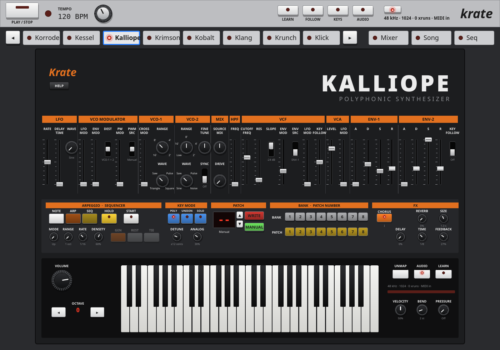

- [Install](#install)
- [The apps](#the-apps): [Krate](#krate-the-rack), [Korrode](#korrode-acid-bass), [Kessel](#kessel-drum-machine), [Kalliope](#kalliope-polysynth), [Krimson](#krimson-multitimbral-synth), [Kobalt](#kobalt-monosynth), [Klang](#klang-sampler), [Konnekt](#konnekt-modular-synth), [Krunch](#krunch-guitar-amp)
- [The approach](#the-approach)
- [Build from source](#build-from-source)
- [Layout](#layout), [License](#license)

## Install

On Debian 13 (or anything with Qt 6.8 and PipeWire), download the `.deb` from the [latest release](https://github.com/pacificnm/krate/releases/latest) and install it:

```sh
sudo apt install ./krate_*_amd64.deb
```

Every app gets its own menu entry and icon (KDE: *Multimedia*): **Krate** for the whole rack, or any instrument on its own. They start through `pw-jack`, so they play through PipeWire; plug in a MIDI keyboard and play. Your sounds, patterns, songs and settings are kept in `~/.local/share` and `~/.config`, and stay when you update or remove the package. More: [packaging/README.md](packaging/README.md).

## The apps

### Krate (the rack)

The rack hosts every instrument at once: one transport (play, stop, tempo), one mixer, and your MIDI keyboard routed to whichever instrument has focus, or to each on its own channel. Click a tab to see and play an instrument; its panel is the same as when it runs on its own.

- **Mixer**: a strip per instrument with three-band EQ, reverb and delay sends, pan, mute, solo and meters; any instrument can be routed into Krunch's input, to play a synth through the guitar amp.
- **Seq**: an 8-track pattern sequencer for the whole rack: 16 patterns of up to 4 bars, a piano roll per track (drum lanes for Kessel), velocity, chains of patterns ([docs/SEQUENCER.md](docs/SEQUENCER.md)).
- **Song**: open a Guitar Pro tab (`.gp`) and/or a MIDI file, put its tracks on Krate's instruments, leave your own part out and play along, with your part's tab scrolling by; a song library keeps every song with its setup and sounds ([docs/SONG_PLAYER.md](docs/SONG_PLAYER.md)).
- **Your choice of instruments**: **+** next to the tabs adds or removes them; one you remove isn't shown or played (no CPU), and comes back with its sound, mixer strip and MIDI links as they were.
- **Audio tracks**: add up to eight from **+**. Each records your interface's inputs (a guitar, a microphone) or any instrument's output: ARM it, press **REC**, then **PLAY**. Takes are 24-bit WAV files in `~/.local/share/krate/recordings` and go on the track's lane where they were recorded; the track panel puts any take on the lane or takes it off.
- **Arranger**: the Arrange screen lays the song out across bars: the sequencer's 8 tracks as lanes of pattern clips and MIDI clips, and the audio tracks' takes. Switch **SONG** on and the arrangement plays; click the ruler to start from a bar, drag **LOOP** and **PUNCH** ranges, arm a lane with **R** and press **REC** to record what you play on the keyboard into a MIDI clip. Clips move, trim, split, duplicate and (audio) fade by dragging, and every edit can be undone (Ctrl+Z). Krate is growing into a DAW from here: automation and export are next ([docs/DAW.md](docs/DAW.md)).

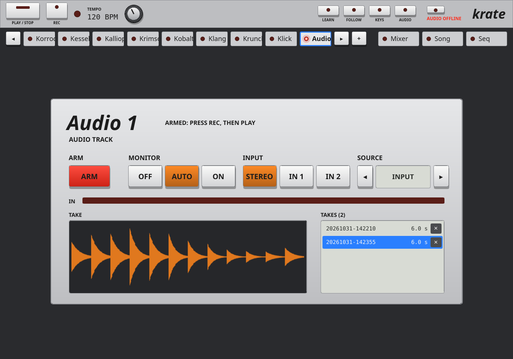

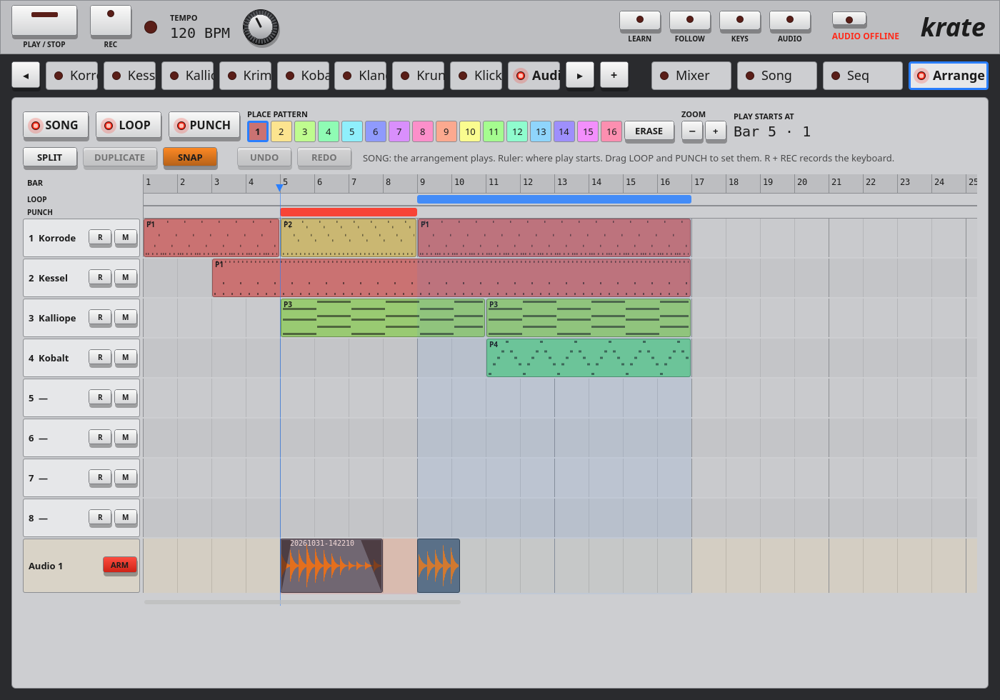

- **MIDI Learn** across the rack: any knob, button or tab to a control on your keyboard.

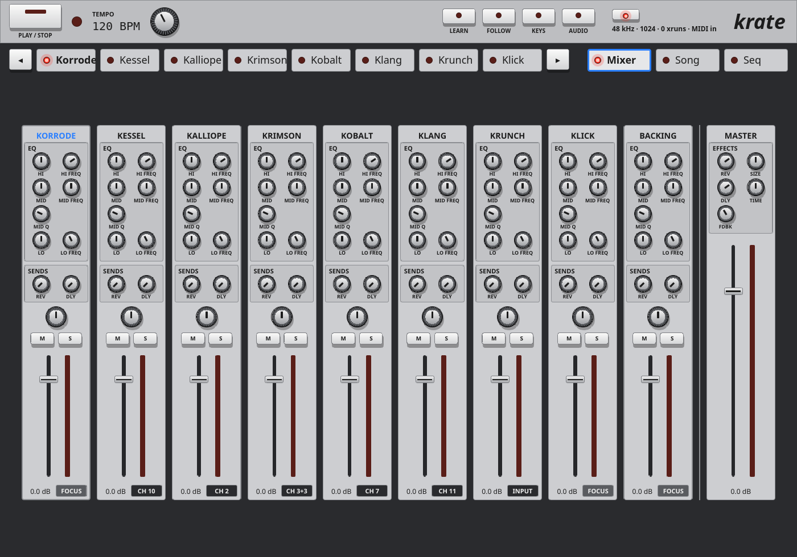

### Korrode (acid bass)

A one-voice bass synth for acid lines: a saw or square oscillator into a resonant, saturating diode-ladder filter, an envelope with accent and slide, a 16-step pattern sequencer with 64 patterns and a randomizer, overdrive, delay and reverb. [More](instruments/korrode/README.md).

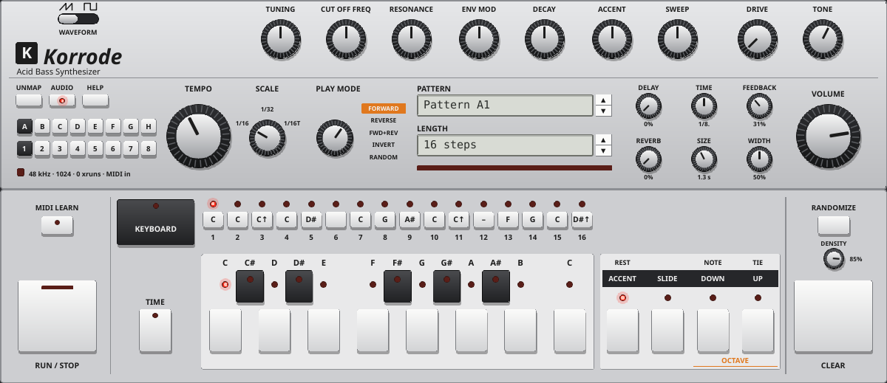

### Kessel (drum machine)

Fifteen synthesized drum voices (kick, snare, toms, rim, clap, hats, cymbals, and industrial metal, clank, noise and boom voices) plus a voice for your own samples, each with its own tuning and shape. A per-voice mixer with drive, gated reverb, delay, compressor and crusher; 16 kits; a tracks × steps sequencer with accent and shuffle, 16 patterns. [More](instruments/kessel/README.md).

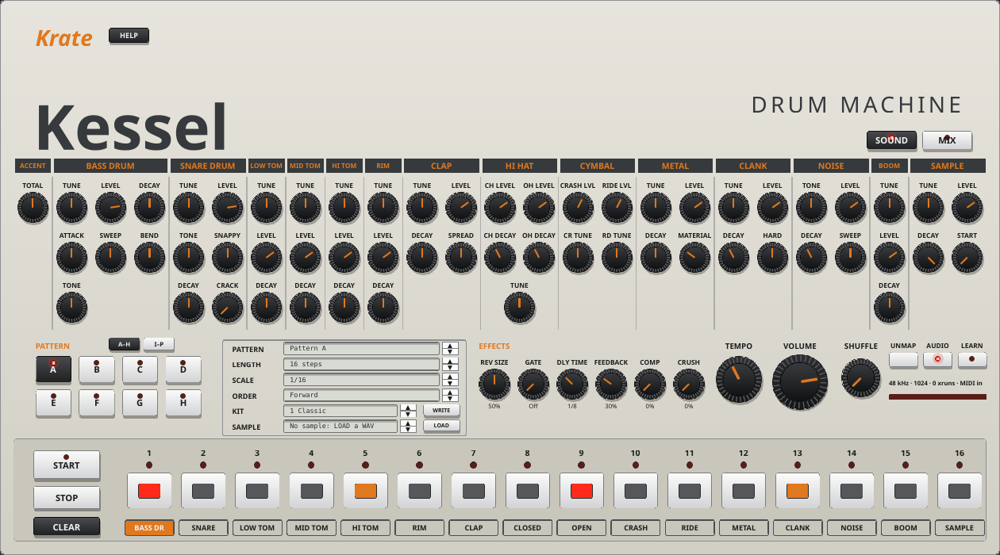

### Kalliope (polysynth)

A 16-voice polyphonic synth: two oscillators with sync and cross-modulation, analog drift, a driven 12/24 dB ladder filter, two envelopes, an LFO with delay, unison, chorus, delay and reverb; 64 patches, an arpeggiator and a step sequencer. Strings, brass, pads, plucks. [More](instruments/kalliope/README.md).

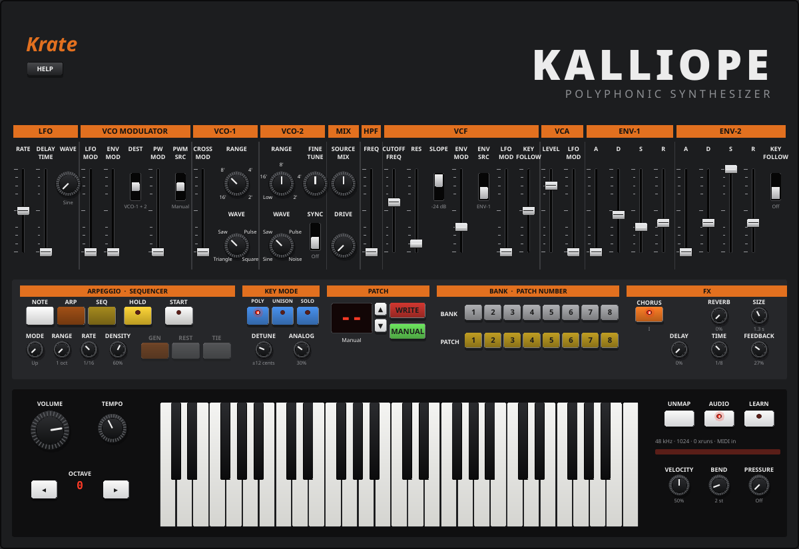

### Krimson (multitimbral synth)

A virtual-analog synth that plays four sounds at once (slots A to D, each on its own MIDI channel or split across the keyboard): two oscillators with sync, FM and ring modulation, a five-mode filter with drive, filter, amp and modulation envelopes, two LFOs, morph between two settings with the wheel or velocity, effects and an arpeggiator per slot. 64 programs, 8 performances. [More](instruments/krimson/README.md).

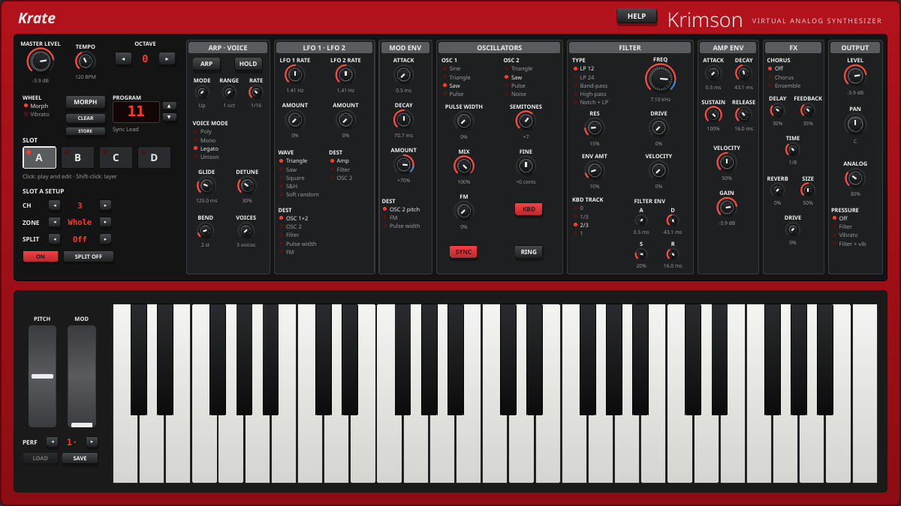

### Kobalt (monosynth)

A one-oscillator monosynth in the classic early-80s style: saw and pulse with width modulation, a sub-oscillator and noise into a self-oscillating four-pole filter, one envelope with gate, trigger and LFO modes, portamento, bender and mod lever, an arpeggiator and a 64-step sequencer with legato; 64 patches. [More](instruments/kobalt/README.md).

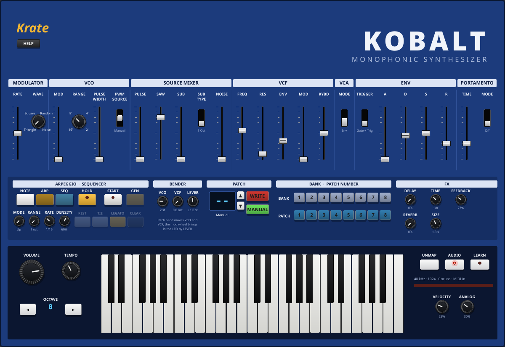

### Klang (sampler)

A sampler and looper: 16 pads playing your WAV and MP3 files as one-shots, held notes or tempo-locked loops, each with filter, drive, bit crusher, ring modulator, trance gate, choke groups and effect sends; slice a loop onto pads (evenly, or at its hits); 16 patterns of up to 64 steps with accent, rolls, reverse and pitch per step. It starts with a kit of its own synthesized sounds. [More](instruments/klang/README.md).

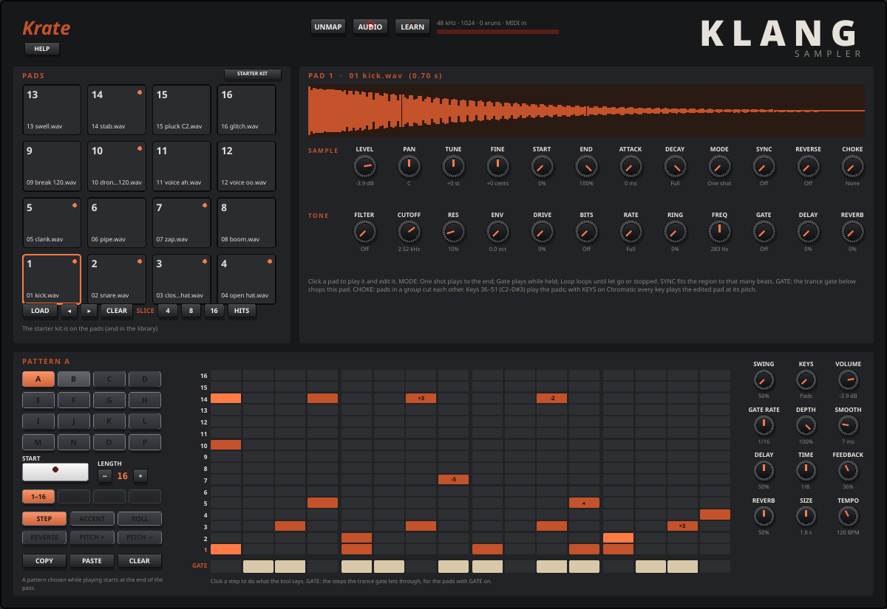

### Konnekt (modular synth)

A modular synthesizer for building sounds and learning how synths work. 23 modules (oscillators, noise, three filters, envelopes, LFOs, VCAs, mixers, sample & hold, slew, ring mod, drive, crusher, effects, a clock and a sequencer) wired with virtual cables; up to 8 voices, played from any MIDI keyboard.

- **See the signals**: every jack is coloured by what it carries and shows its signal live; right-click an output for a scope.
- **Every part explains itself**: hover for a line, right-click anything for the whole story: what it is, how it works, why you'd use it, what to try, and what it's doing in your patch right now.
- **20 lessons**, from a single oscillator to FM, wavefolding and drums from scratch, and **84 presets** (basses, leads, 80s synth-pop, pads, drum grooves, effects) to play and take apart.
- **Send to an instrument**: turn a patch into a Kalliope, Kobalt or Krimson preset, with a report of what came across.

[More](instruments/konnekt/README.md).

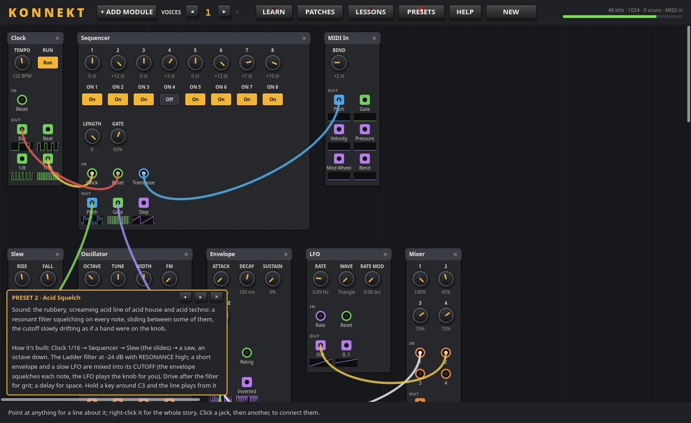

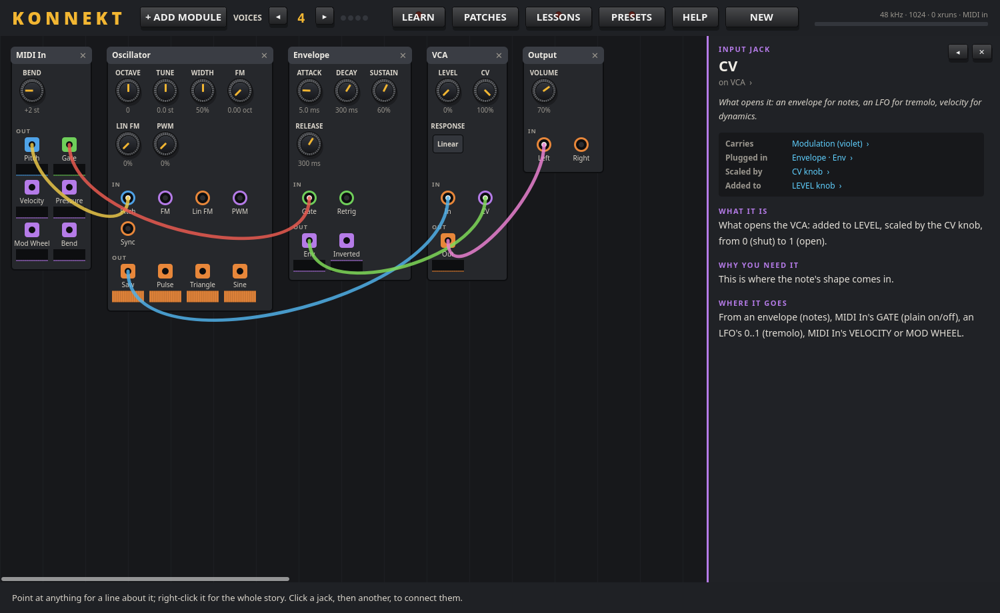

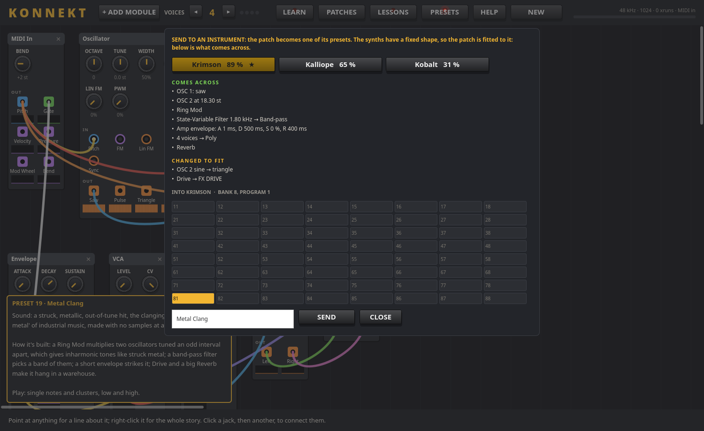

### Krunch (guitar amp)

A guitar amp in the rack, played from your audio interface's input: four channels (clean to high gain) with gain, EQ, presence and a gate, a power amp with sag, cabinets from your own impulse responses (an IR library you import WAVs, folders or zip packs into), a pedalboard in front of the amp and in its effects loop (overdrive, fuzz, compressor, EQs, modulation, delays, reverb), and presets. [More](instruments/krunch/README.md).

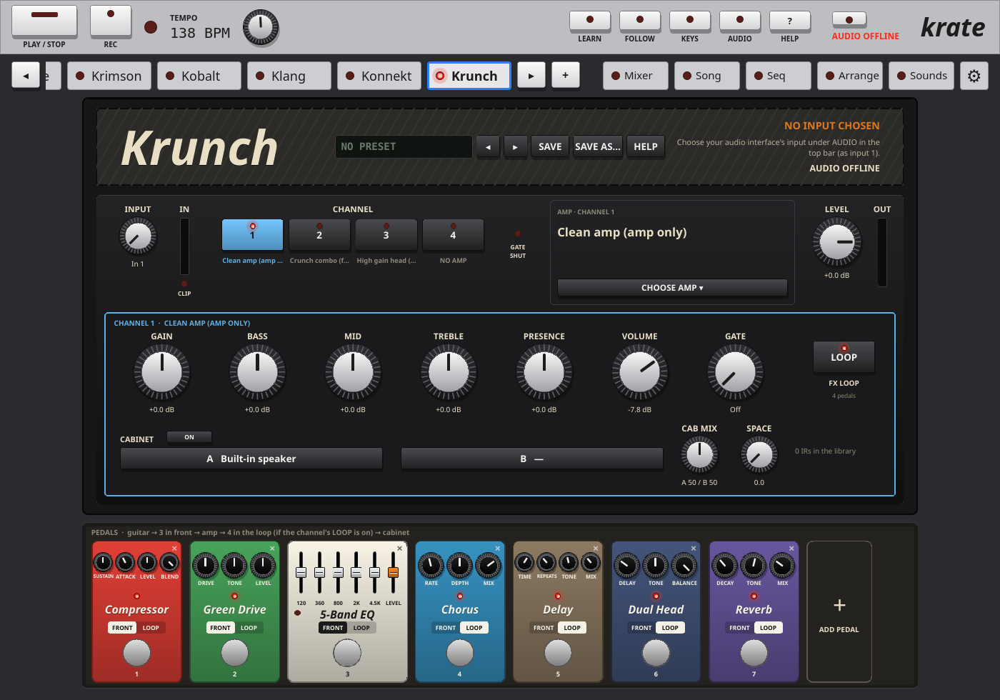

The rack also has **Klick**, a metronome on the shared transport.

### Playing with a DAW

Every app follows a DAW that leads tempo over JACK (Qtractor, Ardour...: set it as the JACK *timebase master* and its transport mode to lead). Tempo, play and stop are then the DAW's: the sequencers, arpeggiators and tempo-synced delays play in time with your project, patterns line up on its bars, and PLAY / STOP in any Krate app starts and stops the DAW too. The status line shows `JACK sync 128 BPM` while it follows. Connect the DAW's MIDI tracks to an instrument's `midi_in` and its outputs to audio tracks to record it. Instrument plugins (each instrument on a DAW track) are next.

## The approach

- **One suite, one foundation.** Everything instrument-neutral lives in `shared/`: the realtime core (no Qt), the JACK host, the transport and step clock, MIDI, effects, the QML controls. Each instrument is the same engine whether it runs as its own app or as a device in the rack, so a sound made standalone is the same in the rack ([docs/SHARED_FOUNDATIONS.MD](docs/SHARED_FOUNDATIONS.MD)).
- **Realtime-safe engines.** The audio thread never locks or allocates: the panels talk to the engines through atomic parameters and lock-free queues, and anything heavy (loading a sample, building a patch) is prepared on the UI thread and handed over.
- **Hardware-style panels you can learn from.** Each instrument looks and plays like a piece of gear: knobs, sliders, buttons, displays. Every control can be MIDI-learned to your keyboard, and every app has its manual built in (HELP).
- **Measured, not guessed.** Each instrument has tests for its DSP (filters, envelopes, voices, character), its patches and its files; sound levels are measured and matched across instruments; 64 test suites run on every push. When something sounds wrong, it's reproduced and measured before it's fixed.
- **Made to teach.** Konnekt exists to show how synths work: live signals, explanations of every part, lessons, presets to take apart, and a way to carry what you build into the other instruments.
- **Synthesized, not sampled.** Every sound in the suite (drums, the sampler's starter kit, the presets) is made by the instruments themselves; your own samples and impulse responses are yours to add.
- **Your files, on your machine.** Patches, kits, patterns, songs and settings are plain JSON (and SQLite for the libraries) in `~/.local/share` and `~/.config`: no accounts, no cloud.
- **Linux-native and free.** JACK and PipeWire, Qt 6.8, C++20, CMake; GPL-3.0.

## Build from source

Debian 13 / KDE Plasma on PipeWire; Qt 6.8, CMake ≥ 3.24, C++20.

```sh
sudo apt install build-essential cmake ninja-build pkg-config \
  qt6-base-dev qt6-base-dev-tools qt6-declarative-dev qt6-declarative-dev-tools \
  qml6-module-qtquick qml6-module-qtquick-controls qml6-module-qtquick-dialogs \
  qml6-module-qtquick-shapes qml6-module-qtquick-layouts qml6-module-qtquick-window \
  qml6-module-qtquick-templates qml6-module-qtqml-workerscript libqt6sql6-sqlite \
  libjack-jackd2-dev zlib1g-dev pipewire-jack
cmake -S . -B build -G Ninja -DCMAKE_BUILD_TYPE=RelWithDebInfo
cmake --build build
ctest --test-dir build
pw-jack ./build/bin/krate          # the rack, with every instrument
pw-jack ./build/bin/konnekt        # or any app on its own: korrode, kessel, kalliope, krimson, kobalt, klang, konnekt
./build/bin/krate-render --bars 8 --out rack.wav   # the rack rendered offline to a WAV
```

To build the `.deb` yourself: `packaging/build-deb.sh` (a clean release build in `build-deb/`, tests, then `dist/krate_<version>_amd64.deb`). Every push and pull request is built and tested by GitHub Actions; a tag `v<version>` publishes a release ([packaging/README.md](packaging/README.md)).

More on building, testing and MIDI without hardware: [instruments/korrode/docs/BUILD.md](instruments/korrode/docs/BUILD.md).

## Layout

```
shared/            instrument-neutral code: core (no Qt), JACK host, Qt helpers, QML controls
instruments/<name> one folder per instrument: DSP, controllers, panel, tools, tests, docs
apps/<name>        thin executables
packaging/         install rules, menu entries, icons, the .deb
docs/              suite-level docs, screenshots
```

Each instrument's folder has its own README, manual (`docs/MANUAL.md`, also the app's HELP) and roadmap.

## License

Copyright (C) 2026 Jaimie Garner

Krate is free software: you can redistribute it and/or modify it under the terms of the GNU General Public License as published by the Free Software Foundation, either version 3 of the License, or (at your option) any later version. See [LICENSE](LICENSE).

It links dynamically against Qt 6 (LGPLv3) and libjack / PipeWire's JACK library (LGPL-2.1 / MIT), all of which are compatible with GPL-3.0-or-later.

Third-party code: `third_party/dr_libs/dr_mp3.h` (MP3 decoding), public domain or MIT No Attribution; see its README.
