# Krate manual

Krate is the rack that holds the instruments: it plays them together on one tempo, mixes them, sequences them, records audio from your audio interface, arranges everything into a song, and plays along with songs you load. Each instrument (Korrode, Kessel, Kalliope, Krimson, Kobalt, Klang, Konnekt, Krunch, Klick) has its own panel and its own manual (its **HELP** button); this manual is about the rack around them.

Most of the window is one screen at a time: an instrument's panel, or one of the rack's own screens (**Mixer**, **Song**, **Seq**, **Arrange**, **Sounds**, **⚙**). The transport bar at the top is always there. Everything is saved as you go: quit and start again and the rack is as you left it.

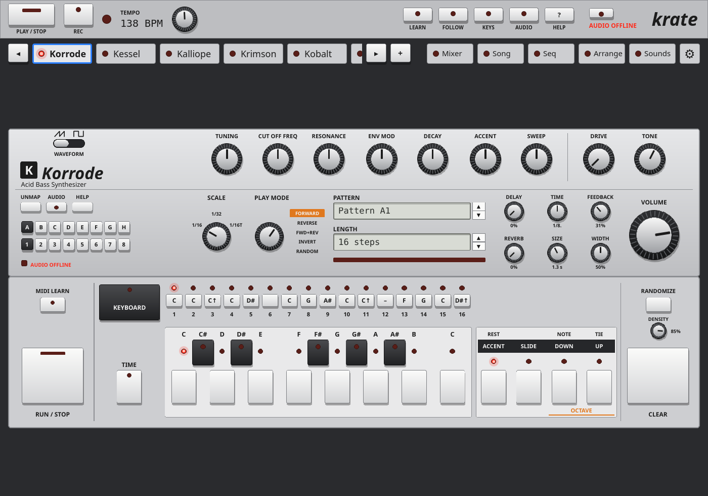

## Quick start

1. **Add instruments.** Press **+** next to the instrument tabs, and click the number next to an instrument (lit: in the rack). Its tab appears; click it to see its panel.
2. **Check the audio.** The LED next to the audio status (right of the top bar) should be lit, with the sample rate and buffer beside it. If it isn't, click it to reconnect, or open **AUDIO** and pick your output.
3. **Play.** Press **PLAY / STOP** (or Space). The instruments that are set to run play their own patterns on the rack's tempo. Turn **TEMPO** to change the speed.
4. **Play your keyboard.** Your MIDI keyboard plays the instrument in focus (the tab with the lit LED). Press Tab, or click another tab, to play another one.
5. **Mix.** Open **Mixer** (M): a fader, pan, EQ, sends, mute and solo for every instrument.
6. **Write a sequence.** Open **Seq** (Q), choose an instrument for track 1, click notes into the piano roll and press **RUN**. **SAVE** keeps it in the library, with the sounds and the mixer.
7. **Record a guitar or a voice.** Press **+** and add an audio track, pick its **SOURCE** (the input your instrument is plugged into), press **ARM**, then **REC** and **PLAY**. The take appears on its lane in **Arrange**.
8. **Make a song.** In **Arrange** (A), switch **SONG** on and click patterns onto the lanes. **PLAY** now plays the arrangement.

## The window

### Transport bar

| Control | What it does |
| --- | --- |
| **PLAY / STOP** | Starts and stops the rack (Space does the same). Every instrument that is running plays, and the Seq screen's tracks play if its **RUN** is on. With **SONG** on (Arrange), the arrangement plays instead. Learnable. |
| **REC** | Recording: while it is lit, armed audio tracks record whenever the transport plays, and armed MIDI lanes (Arrange, **R**) record what you play when **SONG** is on. Press it before or during play. Learnable. |
| The LED | Blinks on the beat. |
| **TEMPO** | The tempo in BPM, shown big. The knob next to it sets it, 40–240 BPM; double-click it for 120. While a song is open on the Song screen, the song sets the tempo. |
| **LEARN** | MIDI Learn on and off (also the L key; Esc leaves it). See *MIDI Learn*. |
| **FOLLOW** | Follow focus: a knob learned while this is lit moves the same knob on whichever instrument has focus, instead of always the one it was learned on. |
| **KEYS** | Your MIDI keyboard: how many keys it has and where they start, so the on-screen keyboards match it, and which channel plays the instrument in focus. See *Settings: MIDI and keys*. |
| **AUDIO** | Where Krate plays to, which input of your audio interface each **IN** is, and the buffer size (the same settings as **⚙ ▸ Audio**). Lit while the popup is open, or while input 1 or 2 is connected. |
| Audio status (LED and text) | Lit while Krate is connected to the audio system; the text shows the sample rate, the buffer and any dropouts, red when audio is offline. Click the LED to reconnect. When a newer Krate is out, a line here says so: click it for **⚙ ▸ Updates**. |

### Instrument tabs

| Control | What it does |
| --- | --- |
| **The instrument tabs** | One for each instrument and audio track in the rack. Click one to give it focus (its LED lights) and show its panel; your MIDI keyboard plays it. When there are more tabs than room, they scroll, keeping the focused one in view. Each tab is learnable, so a button on your controller can focus that instrument. |
| **◂ ▸** | Focus the previous or next instrument (Tab does ▸). Learnable. |
| **+** | Add or remove instruments, copies, audio tracks and plugin slots (below). |

**+** opens a list of everything that can be in the rack. A lit button is in the rack; click it to add or remove it.

- **Instruments**: each has buttons **1** to **16**. **1** is the instrument itself, **2** and on are copies ("Korrode 2"), each with its own sound, its own mixer strip and its own tab: two bass lines, two drum machines, three amps.
- **AUDIO TRACKS**: numbered buttons, one per audio track (see *Audio tracks*).
- **PLUGIN SLOTS**: numbered buttons, each a slot for a plugin installed on this computer, picked on the slot's panel (see *Plugin slots*).

Removing something keeps its sound, its mixer settings and its MIDI links for when you add it back; it isn't played or shown meanwhile. A track or effect that took its input from it goes back to the audio interface's input.

### Screen tabs

| Control | What it does |
| --- | --- |
| **Mixer** | The mixer (M). |
| **Song** | The song player: play along with tab and MIDI files (S). |
| **Seq** | The rack sequencer: patterns for every instrument (Q). |
| **Arrange** | The arranger: patterns, recordings and automation along the bars (A). |
| **Sounds** | The sound library (O). |
| **⚙** | Settings (Ctrl+,). A red dot on it: an update is out, or a change waits for Krate to start again. |

Click a lit screen tab again to go back to the instrument's panel, or click an instrument's tab. Every screen tab is learnable.

### Keyboard shortcuts

| Key | What it does |
| --- | --- |
| Space | Play / stop. |
| Tab | Focus the next instrument. |
| M, S, Q, A, O | Show or hide Mixer, Song, Seq, Arrange, Sounds. |
| Ctrl+, | Show or hide Settings. |
| L | MIDI Learn on / off. |
| Esc | Leave MIDI Learn. |
| Ctrl+Z, Ctrl+Shift+Z | Undo, redo (on the Arrange screen). |
| Ctrl+D | Duplicate the selected clip (Arrange). |
| Delete, Backspace | Remove the selected clip (Arrange). |
| ↑ ↓ | Step through the sound list, playing each sound (Sounds). |

### If Krate went wrong last time

When the last session crashed or didn't end properly (killed, frozen, a power cut), a red banner says so at the next start. **VIEW** reads the crash report; **DISMISS** hides the banner (the report is kept: **⚙ ▸ Crash reports**).

## Mixer

A strip for every instrument, audio track and plugin slot in the rack, and the **Master** at the right. The strips grow to fill the screen; when there are more than fit, they scroll sideways and the master stays put. Every knob, fader and button on the mixer is learnable.

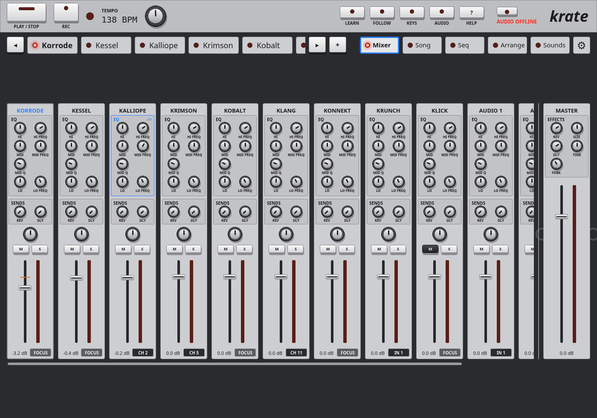

| Control | What it does |
| --- | --- |
| **EQ** | Three bands: **HI** (a shelf) and **HI FREQ** (1.5–16 kHz), **MID** (a peak), **MID FREQ** (100 Hz – 10 kHz) and **MID Q** (wide to narrow), **LO** (a shelf) and **LO FREQ** (30–600 Hz). Each gain is ±15 dB. "on" shows when the EQ isn't flat; double-click the word **EQ** to make it flat again. |
| **SENDS: REV, DLY** | How much of the strip goes to the rack's reverb and delay, after the fader. Off at the left. |
| **Pan** | Left to right; double-click for the centre. |
| **M** | Mute. |
| **S** | Solo: only the soloed strips play. |
| **Fader** | The strip's level, shown in dB under it; the meter beside it shows what comes out. |
| **CH** / **FOCUS** | The strip's MIDI channel. **FOCUS**: your keyboard reaches it when it has focus. **CH 1**–**CH 16**: notes on that channel always reach it (pads, a second keyboard, other gear). Click for the next, right-click or the wheel for the previous, double-click for the instrument's own defaults. An instrument with several channels shows the first and how many more (**CH 3+3**). |
| Input source (orange or dark box) | On strips that take audio in (Krunch, audio tracks, plugin effects), in place of the MIDI channel: where the sound comes from. **IN 1**, **IN 2**…: an input of your audio interface (which one each is wired to is set in **AUDIO**). An instrument's name: that instrument's own output, so you can run a synth through the amp, or record a drum machine onto an audio track. Click for the list, right-click or the wheel for the previous or next. Orange when it is fed by another instrument. |

The **Master** strip:

| Control | What it does |
| --- | --- |
| **EFFECTS: REV** | The reverb's level (what the strips send comes back at this level). |
| **SIZE** | The reverb's decay, in seconds. |
| **DLY** | The delay's level. |
| **TIME** | The delay time, on the tempo: **1/16**, **1/8T**, **1/8**, **1/8.**, **1/4**, **1/4.**, **1/2**. |
| **FDBK** | How many repeats, 0–90 %. |
| **Fader** | Krate's output level, with the output meter. |

The Song screen's backing track has its own strip, **Backing**.

## Seq: the rack sequencer

The Seq screen plays any instrument in the rack from patterns of notes: 16 patterns, each up to 4 bars, with 16 tracks; each track plays one instrument. It runs on the rack's tempo, next to (or instead of) the instruments' own sequencers.

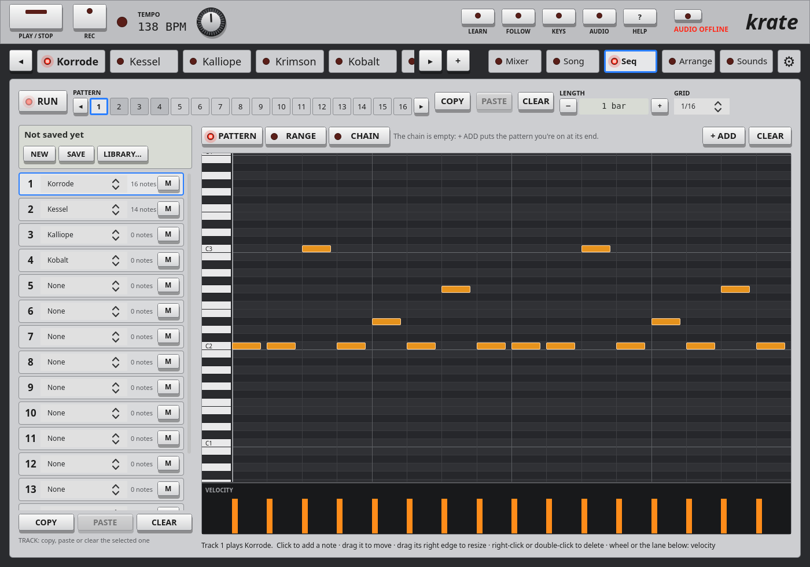

### The top row

| Control | What it does |
| --- | --- |
| **RUN** | Plays or stops the sequencer. From silence it starts the transport with the sequencer alone; while the rack plays it joins in, or stops (and stops the rack too, when nothing else is running). Its LED is lit while it plays, or dimmed when it will play at the next **PLAY**. Learnable. |
| **PATTERN ◂ 1 … 16 ▸** | The pattern you see and edit, and which plays next (at the end of the bar while playing). Lit frame: the one shown; grey: has notes; a red dot: playing now. **◂ ▸** step through them (learnable). |
| **COPY / PASTE** | Copy the pattern shown, pick another, paste over it. |
| **CLEAR** | Empties the pattern shown, every track. |
| **LENGTH − +** | The pattern's length: a bar shorter or longer, up to 4 bars; below a bar, **−** takes a step off at a time. |
| **GRID** | The step size: **1/16**, **1/32**, **1/16T**, **1/8T** (triplets). Clicks place notes of one step, and notes snap to it. Each pattern has its own. |

### Tracks

| Control | What it does |
| --- | --- |
| **1 … 16** | Click a track to edit it in the piano roll. |
| Instrument (the list on each track) | What the track plays: **None**, or an instrument in the rack (Krimson's four parts each have their own). One that isn't in the rack any more shows "(not in rack)". |
| Notes | How many notes the track has in this pattern. |
| **M** | Mutes the track. |
| **COPY / PASTE / CLEAR** (under the tracks) | The selected track's notes in this pattern: copy them, paste them over another track or pattern, or clear them. The line under them says what was copied. |

### What plays: PATTERN, RANGE, CHAIN

| Control | What it does |
| --- | --- |
| **PATTERN** | Loops the pattern you choose. |
| **RANGE** | Plays patterns **FROM** to **TO** in order, then around again. The patterns in the range are underlined. Learnable. |
| **CHAIN** | Plays the chain: a list of patterns, each played a number of times. Learnable. |
| The chain's steps | Click a step to edit its pattern; the wheel over it sets how many times it plays (×2, ×3…); right-click removes it. The step playing has a red frame. |
| **+ ADD** | Puts the pattern you're on at the end of the chain. |
| **CLEAR** | Empties the chain. |

### The piano roll

The roll shows the selected track in the pattern shown. For most instruments the rows are the keys of a piano (C4 and the other Cs are named; it starts around your notes). For Kessel the rows are its drums by name; for Klang they are its pads, by the sound on each.

| Action | What it does |
| --- | --- |
| Click an empty place | A note of one grid step. |
| Drag a note | Moves it, along the steps and to another row. |
| Drag a note's right edge | Makes it longer or shorter (not on Kessel's drums, which are hits). |
| Right-click or double-click a note | Deletes it. |
| Wheel over a note | Its velocity up or down. |
| **VELOCITY** lane | A bar for each note: drag it up or down. On Kessel, 100 and up plays the drum accented. |

The red line is the playhead, while the pattern shown is playing. The line under the roll says what the track plays and recalls these actions.

### The sequence box: NEW, SAVE, LIBRARY…

The box above the tracks (and at the right of the Arrange screen's editing row) is the open sequence. A saved sequence is also an arrangement: it keeps its patterns, tracks, chain and range, the whole arrangement (the MIDI clips, the automation and the audio tracks' clips), and the instruments' sounds and the mixer as they were when you saved it. Open it again later and the rack sounds as it did.

| Control | What it does |
| --- | --- |
| The name | The open sequence's name, and "• changed" when it has changes not saved yet; "Not saved yet" when it has never been saved. |
| **NEW** | Starts an empty sequence and arrangement. The tracks keep their instruments; the audio clips leave the lanes (the takes stay in each track's list). With unsaved changes it asks first: press **DROP CHANGES?** within 4 seconds to go ahead. |
| **SAVE** | Saves over the open sequence (its sounds and mixer too). Never saved yet: opens the library to give it a name. |
| **LIBRARY…** | The saved sequences (below). |
| **CLOSE** | Closes the open sequence and puts back what was on the rack before you opened one: patterns, arrangement, sounds and mixer. |

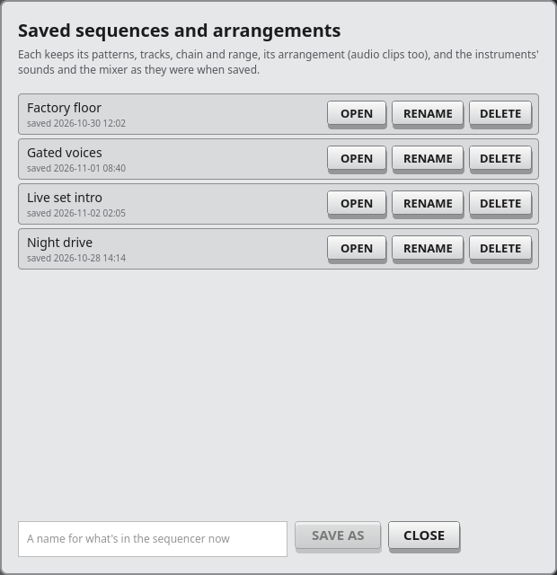

**LIBRARY…** lists the saved sequences, with when each was saved; "(open)" marks the open one.

| Control | What it does |
| --- | --- |
| **OPEN** | Opens it: its patterns, its arrangement and audio clips, its sounds and its mixer. With unsaved changes it asks first: **OPEN, DROP CHANGES**. **RUN** stays as it was. |
| **RENAME** | Type a new name, then **OK** (or Enter). |
| **DELETE** | Press twice (**REALLY DELETE**). Deleting the open one leaves what's on screen as it is, just no longer saved. |
| Name field and **SAVE AS** | Saves what's on the rack now as a new sequence with that name (or Enter); it becomes the open one. |
| **CLOSE** | Closes the list. |

## Arrange: the arranger

The Arrange screen lays the sequencer's 16 tracks and the audio tracks out as lanes across the bars: pattern clips, recorded MIDI clips, audio takes, and automation lanes for any knob. Switch **SONG** on and **PLAY** plays the arrangement from start to end.

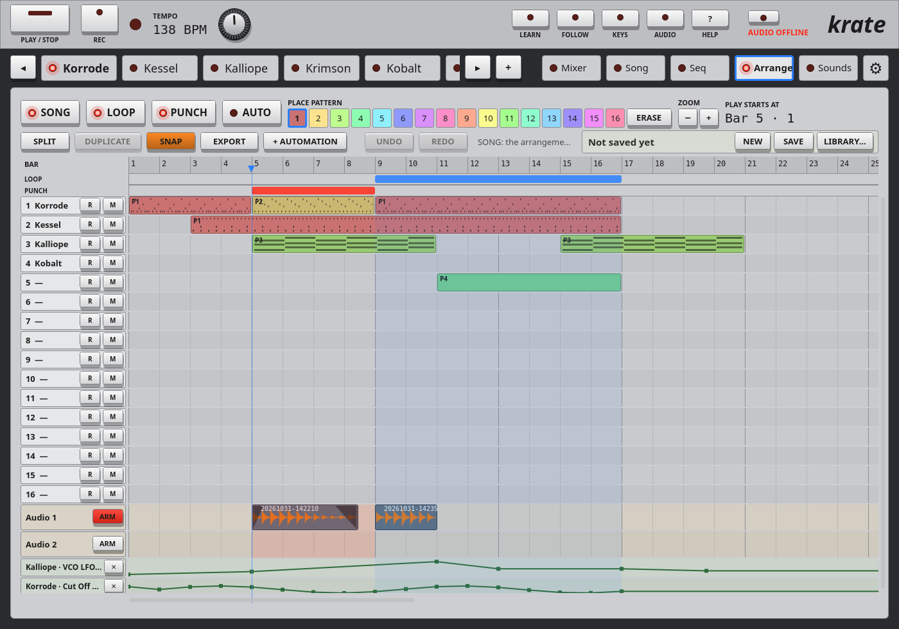

### The top row

| Control | What it does |
| --- | --- |
| **SONG** | Song mode: **PLAY** plays the arrangement instead of the patterns. Off: patterns play as the Seq screen says. |
| **LOOP** | Plays the loop range round and round (with **SONG** on). Set the range by dragging across bars in the **LOOP** strip under the ruler. |
| **PUNCH** | Armed audio tracks (and armed MIDI lanes) record only inside the punch range (with **SONG** on). Drag across the **PUNCH** strip to set it. |
| **AUTO** | Automation recording: knobs you turn while the song plays are recorded into their lanes (with **SONG** on). |
| **PLACE PATTERN 1 … 16** | The pattern a click on a MIDI lane places. Each pattern has its own colour. |
| **ERASE** | While lit, a click on a clip or an automation point removes it. |
| **ZOOM − +** | Narrower or wider bars. |
| **PLAY STARTS AT** / **PLAYING** | Where the song starts (Bar · beat), or where it is while playing. |

### The editing row

| Control | What it does |
| --- | --- |
| **SPLIT** | While lit, a click on a clip cuts it there (a MIDI clip at a bar line, an audio clip at the beat, or anywhere with **SNAP** off). |
| **DUPLICATE** | A copy of the selected clip right after it (Ctrl+D). |
| **SNAP** | Lit: audio clips move and trim in whole beats, automation points in quarter beats. Off: freely. MIDI clips always move in whole bars. |
| **EXPORT** | Renders the song to a WAV file (below). |
| **+ AUTOMATION** | Adds an automation lane: pick an **INSTRUMENT**, then a knob (**KNOB: A CLICK ADDS ITS LANE**). |
| **UNDO / REDO** | Takes back or redoes any edit on this screen (Ctrl+Z, Ctrl+Shift+Z). |
| The sequence box | **NEW**, **SAVE**, **LIBRARY…**, **CLOSE**, as on the Seq screen: the arrangement belongs to the open sequence. |

The line between them says what the screen is doing: song mode or not, recording, how many notes have been recorded. When another music program on this computer leads Krate's transport, it says so: that program's position and loop play, and Krate's start, **LOOP** and **PUNCH** wait.

### Lanes

| Control | What it does |
| --- | --- |
| The ruler (**BAR**) | Bar numbers. A click sets where play starts (▼). |
| **LOOP** / **PUNCH** strips | Drag across bars to set the range; it switches **LOOP** or **PUNCH** on. Dim: set but off. |
| MIDI lanes (1–16) | The sequencer's tracks, named by their instrument. A click on an empty place puts the **PLACE PATTERN** pattern there for a bar; drag to the right for a longer clip (the pattern repeats). |
| **R** | Arms the lane for recording what you play into a MIDI clip; it also gives the lane's instrument focus, so you hear what you play. Record with **SONG** and **REC** on, then **PLAY**. |
| **M** | Mutes the track (the same as **M** on the Seq screen). |
| Audio lanes (**Audio 1**…) | One per audio track in the rack: the takes placed on it. A red LED: recording now. |
| **ARM** | Arms the audio track for recording (the same as **ARM** on its panel). |
| Automation lanes | One per knob you added, named by instrument and knob. **✕** removes the lane. |

When there are more lanes than room, they scroll: the wheel over them, or the bar at the side. Shift and the wheel, or a sideways swipe, moves along the bars. While playing, the view turns the page to keep the playhead in sight.

### Editing clips

| Action | What it does |
| --- | --- |
| Click a clip | Selects it. |
| Drag a clip | Moves it: a MIDI clip in whole bars, and to another MIDI lane too; an audio clip in beats (**SNAP** off: freely). |
| Drag a clip's left or right edge | Trims it. |
| Drag the selected audio clip's top corners | Fade in (left) and fade out (right). The shaded part is what the fade takes away. |
| Double-click a pattern clip | Opens its pattern in the Seq screen. |
| Right-click a clip, or Delete | Removes it. |

A pattern clip shows **P1**…**P16** and a sketch of its notes; a recorded clip shows **MIDI**. An audio clip shows its waveform and the take's name.

### Recording audio

1. Add an audio track (**+**), and on its panel choose its **SOURCE** and **CHANNELS** (see *Audio tracks*).
2. Press **ARM** (on the lane or on the panel).
3. Press **REC**, then **PLAY**. With **SONG** on, the take lands where you recorded it.

The take shows on its lane as it records: red, with **● REC**, its waveform growing live. Press **PLAY / STOP** to end it; it stays on the lane as a clip, and in the track's list of takes.

With **LOOP** on, each time the loop goes round the armed tracks start a new take, and the takes stack on the lane, the latest on top: play a part several times and keep the best. Switch **LOOP** off for one long take. With **PUNCH** on, only the punch range records.

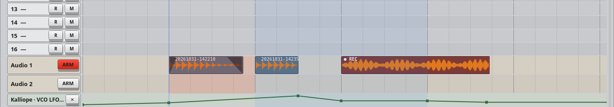

### Recording MIDI

Arm a MIDI lane with **R** (its instrument gets focus), switch **SONG** and **REC** on, and press **PLAY**. What you play on your keyboard becomes a **MIDI** clip on the lane. With **LOOP** on, notes held over the loop's end are ended there.

### Automation

| Action | What it does |
| --- | --- |
| Click on the lane | Adds a point there (its height is the knob's value). |
| Drag a point | Moves it; its value shows as the knob shows it. |
| Right-click a point | Removes it. |
| **AUTO** on, **SONG** on, play | Knobs you turn are recorded into their lanes. |

### Export

**EXPORT** opens **EXPORT TO WAV**:

| Control | What it does |
| --- | --- |
| **WHOLE SONG** | From the song's start to its last clip (its length shows). |
| **LOOP RANGE** | Only the loop range (its bars show). |
| **STEMS** | Each track to its own file too, as it sounds in the mix. |
| **METRONOME** | Includes the metronome. |
| **EXPORT** / **STOP** | Starts the export, or stops it. It renders faster than real time, through the mixer, the effects and the automation as you hear them, into a 24-bit WAV file. |
| **OPEN FOLDER** | Opens the exports folder (`~/Music/Krate` unless you chose another in **⚙ ▸ Folders**). |
| **CLOSE** | Closes it. |

## Audio tracks

An audio track records from your audio interface's inputs (or from another instrument) and plays its takes in the arrangement. Add them from **+** (**AUDIO TRACKS**); each has a tab, a mixer strip and a lane on the Arrange screen.

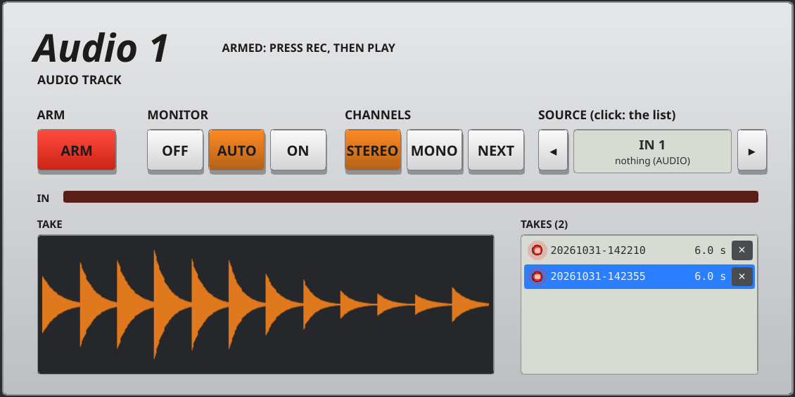

| Control | What it does |
| --- | --- |
| **ARM** | Arms the track for recording. Above it, **ARMED: PRESS REC, THEN PLAY** (or **RECORDS WHEN YOU PLAY** once **REC** is lit); **RECORDING** while it records. Learnable. |
| **MONITOR** | Whether you hear the input through Krate. **OFF**: never. **AUTO**: while the track is armed. **ON**: always. |
| **CHANNELS** | **STEREO**: the source's input and the next one (input 1 and 2). **MONO**: the source's input alone. **NEXT**: mono, from the input after it (input 2 when the source is IN 1). |
| **SOURCE** | Where the sound comes from: **IN 1** … **IN 8** (your interface's inputs, with what each is wired to, set in **AUDIO**), or another instrument's output (record a synth or a drum machine as audio). Click for the list; **◂ ▸** for the previous or next. The same as the input box on the track's mixer strip. |
| **IN** | The input's level. Keep the loudest parts out of the red. |
| **TAKE** | The selected take's waveform. |
| **TAKES** | Every take of this track, newest last, with its length (**M**: mono). Click one to see it. Its LED: lit when it is on the lane (it plays); click the LED to put it on the lane or take it off. **✕**, then **SURE?**, deletes the take and its file. |

**Disarm the tracks you're not recording on.** An armed track with **MONITOR** on **AUTO** plays its input dry. If you play a guitar through Krunch and an audio track is armed on the same input, you hear the guitar twice: once through the amp, once dry. Disarm that track, or set its **MONITOR** to **OFF**.

To record your guitar with the amp's sound, set the audio track's **SOURCE** to Krunch instead of the input: the take is what you hear.

## Plugin slots

A plugin slot holds a plugin installed on this computer: an instrument played like the others, or an effect fed by another device. Add slots from **+** (**PLUGIN SLOTS**).

| Control | What it does |
| --- | --- |
| **LOAD** / **CHANGE** | Picks a plugin from those found on this computer (**RESCAN** looks again). Krate looks in the standard plugin folders and in the ones you add in **⚙ ▸ Folders ▸ PLUGIN FOLDERS**. |
| **UNLOAD** | Empties the slot. |
| **EDITOR** | Opens the plugin's own window. |
| **SOURCE** | For an effect: which device's output goes through it. Mute that device's own strip to hear only the effect. |
| The knobs | The plugin's controls, a bar each: drag; double-click puts one back. |

## Song: the song player

The Song screen plays along with songs: a tab file and/or a MIDI file of the same song. Give each of the song's tracks an instrument in the rack, mute your own part, and play it yourself while your track's tab or notation scrolls with the song. A recording of the song can play along in sync.

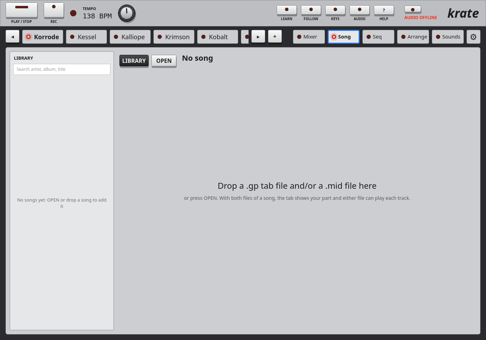

### The top row

| Control | What it does |
| --- | --- |
| **LIBRARY** | Shows or hides the song library at the left: artists, their albums and their songs, with a search. Click a song to open it. A dot marks songs with their sounds saved. |
| **OPEN** | Opens a tab file or a MIDI file (or both). You can also drop them on the screen. A file opened alone brings its namesake from the same folder with it. Opened songs join the library. |
| **EDIT** | The song's details (artist, album, title, track number): **APPLY**, **CANCEL**, or **REMOVE** (twice) to take the song and its files out of the library. |
| **\|◂** | Back to the start. |
| **PLAY** / **STOP** | Plays or stops the song (the same as **PLAY / STOP**). |
| **BAR** | Where the song is: bar.beat / how many bars, and the time. |
| BPM | The song's tempo at this point. |
| **SAVE** | Saves the instruments' sounds and the mixer with this song, so they come back when you open it. |
| **CLOSE** | Closes the song. |

While a song is open, the instruments' own sequencers are off and the song's tempo runs the rack.

### Backing track

| Control | What it does |
| --- | --- |
| **LOAD MP3…** | An MP3 recording of the song to play along with, in sync (or drop one on the screen). |
| **BAR 1 AT** | Where the song's bar 1 is in the recording (minutes:seconds.milliseconds; negative before the recording starts). Type it, or nudge it with **−BEAT**, **−0.1**, **−0.01**, **+0.01**, **+0.1**, **+BEAT**. |
| **REPLACE…** | Another MP3 for this song. |
| **×** | Removes the backing track from the song. |

Its level is the mixer's **Backing** strip.

### Tracks

| Column | What it does |
| --- | --- |
| **MINE** | Your track: click its LED. Its part comes into view. |
| **TRACK** | The track's name (and for a stringed instrument its strings and tuning). Click a row to see that track's tab or notes. |
| **PART**, **NOTES** | Its part and how many notes it has. |
| **INSTRUMENT** | Which instrument in the rack plays it, or **None**. |
| **LEVEL** | Its level. |
| **M**, **S** | Mute (mute your own part to play it yourself), solo. |
| **FROM** | **TAB** or **MIDI**: which file the track plays from, when both are open. |
| ▴ / ▾ | Folds the track list away so the tab gets the whole screen, or unfolds it. |

### The tab view

| Control | What it does |
| --- | --- |
| **TAB** / **NOTES** | Shows the track as tab or as notation (drum tracks: notes only). |
| Click a bar | Goes there. |
| Shift-click bars | Selects bars, from the first one picked (**×** clears the selection). |
| **TO SEQ** | Copies bars of this track into the sequencer: **Bars** from / **to**, **Into pattern** and **track**, **Playing** (the instrument). It says how many patterns it fills (up to 4 bars a pattern) and which notes it will replace. **COPY**, then **SHOW IN SEQ**. |

While playing, the cursor's line goes to the top, so the next lines are in view.

## Sounds: the sound library

The Sounds screen is a library of your sound files (WAV and MP3): browse them by category, listen, and send them to Klang's pads or Kessel's drums.

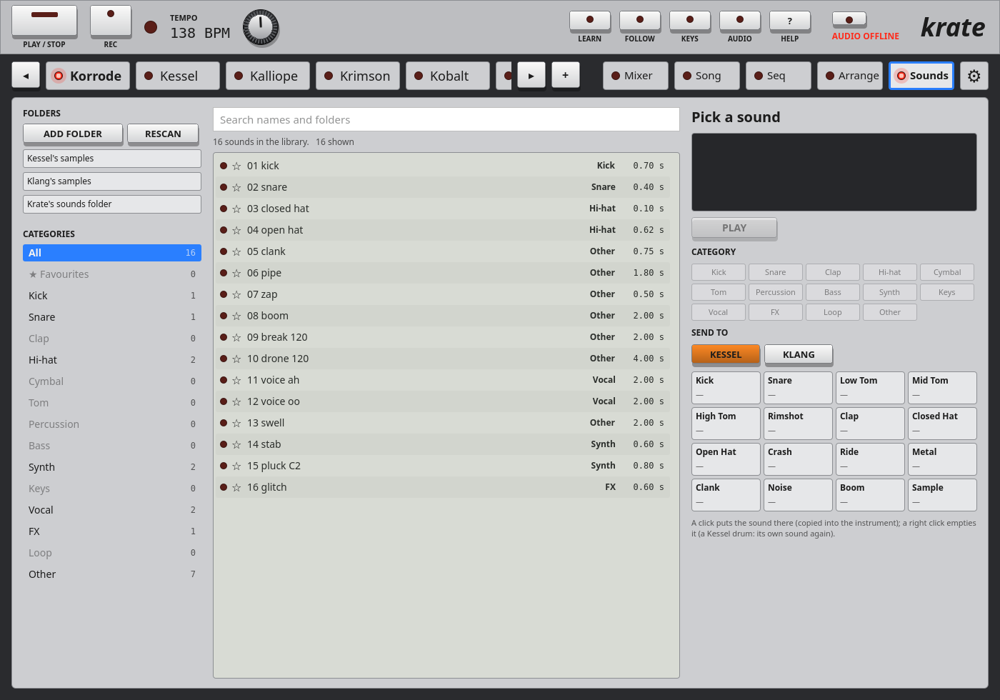

| Control | What it does |
| --- | --- |
| **ADD FOLDER** | Points the library at a folder of sounds (sample packs, your drum sounds), at any depth. Nothing is copied: the files stay where they are. |
| **RESCAN** (**LOOKING…**) | Looks through your folders again for new or removed sounds. Your categories and favourites are kept. |
| The folders | **✕** takes a folder out of the library (the files stay). Krate's own folders are always there and can't be taken out: Krate's sounds folder, and Klang's and Kessel's samples folders. What you put in those shows up by itself a moment later. |
| **CATEGORIES** | **All**, **★ Favourites**, then Kick, Snare, Clap, Hi-hat, Cymbal, Tom, Percussion, Bass, Synth, Keys, Vocal, FX, Loop, Other, with how many of each. A sound's category is guessed from its file and folder names. |
| Search | Finds names and folder names. |
| The list | Click a sound to play it (over Krate's output, whatever the transport is doing). ↑ ↓ step through the list, playing each. **☆** / **★** marks a favourite. |
| **PLAY** / **STOP** | Plays or stops the chosen sound. |
| **CATEGORY** | Sets the chosen sound's category; yours is kept from then on. |
| **SEND TO** | Pick **KLANG** or **KESSEL** (they must be in the rack), then click a pad or a drum: the sound is copied into that instrument and goes there. A right click empties a pad, or gives a Kessel drum its own synthesized sound back. |

## Settings ⚙

Settings has six sections, listed at the left.

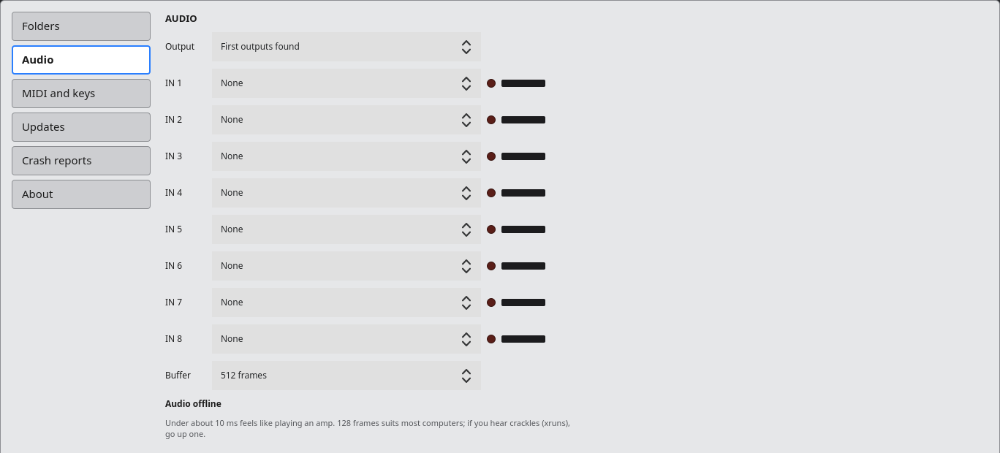

### Folders

Where Krate keeps things: **Krate's data**, **Recordings**, **Song library**, **Exports**, **Instruments' sounds**. Each shows what it holds and its path ("(yours)" when you chose it).

| Control | What it does |
| --- | --- |
| **CHOOSE…** | Pick another folder. Krate then asks: **MOVE MY FILES THERE** (at the next start, your files go to the new folder first; only into a folder that's new or empty), **USE WHAT'S THERE** (use the new folder as it is), or **CANCEL**. |
| **DEFAULT** | Back to the default folder (the same question). |
| **CANCEL** (on a waiting change) | Keeps the folder as it is. |
| **RESTART KRATE NOW** | Folder changes wait for Krate to start again (exports change at once). This restarts it now. |
| **AT THIS START** | What the last start did with folder changes. |
| **PLUGIN FOLDERS** | Where plugins are looked for, yours first, then the standard places. **ADD A FOLDER…**, **REMOVE**. A change looks again at once. |

### Audio

| Control | What it does |
| --- | --- |
| **Output** | Where Krate plays to: **First outputs found**, or a device by name ("(unplugged)" when it isn't there). |
| **IN 1** … **IN 8** | Which input of your audio interface each of Krate's inputs is: the names used by the mixer, the audio tracks and Krunch. **None**: nothing. The LED is lit when it is connected; the bar shows its level. |
| **Buffer** | **The audio server's own**, or 64 … 1024 frames. Smaller is quicker to respond; if you hear crackles, go up one. 128 suits most computers. |
| The delay line | The delay from input to speakers, in ms. Under about 10 ms feels like playing an amp. |

### MIDI and keys

| Control | What it does |
| --- | --- |
| **YOUR MIDI KEYBOARD: Keys** | How many keys it has (13–88). |
| **First key's note at octave 0** | The note of its lowest key, with the keyboard's octave buttons at 0. |
| **Octaves down / up** | How far its octave buttons go. |
| **SET FROM KEY** | Press it (**PRESS LOWEST KEY**), then your keyboard's lowest key, at octave 0, with Krimson or Kalliope in view. |
| **DEFAULTS** | 49 keys, first note 35, octaves −3 to +4. |
| **Keys play focus on** | **Any channel**: every note goes to the instrument in focus. **Channel 1–16**: notes on that channel go to the instrument in focus; other channels go by the mixer's **CH**. **Off: mixer channels**: notes go to the instrument holding their channel, else to the one in focus. |
| **MIDI INPUTS: Every MIDI device** | Krate listens to every MIDI device plugged in; they all play together (tell them apart by channel). |
| **Only those named** | Off **Every MIDI device**: type part of a device's name as it shows in your system's MIDI list. |
| **Program Change n focuses the nth instrument in the rack** | On: a Program Change switches the instrument in focus. Off: it goes to the instrument as a program change. |

These are also in the **KEYS** popup on the transport bar.

### Updates

| Control | What it does |
| --- | --- |
| **Check by itself** | Krate looks for a newer version when it starts, then twice a day. |
| **CHECK NOW** | Looks now. |
| **UPDATE TO** *version* | Downloads, checks and installs the new Krate, with its release notes shown under it. On the player, Krate starts again with it by itself (about a minute); on a desktop, quit and start Krate again. Your sounds, songs, sequences and settings stay. |

When a newer Krate is out, the top bar says so and **⚙** has a red dot. Without a network, it says so and nothing changes.

### Crash reports

**VIEW REPORTS**: what Krate wrote down when it crashed or didn't end properly, newest first: what happened, when, and the log before it. **DELETE**, **DELETE ALL**, **CLOSE**. The last 30 are kept.

### About

Krate's version, whether it runs on the player or a desktop, and where its files are.

## MIDI Learn

Any control with a learn outline can be moved from your MIDI controller: the transport, the tabs, the screen tabs, the mixer, the Seq screen's **RUN**, patterns and modes, the instruments' knobs and buttons.

1. Press **LEARN** (or L). Learnable controls get an outline.
2. Click a control (it pulses), then move a knob or press a pad or button on your controller. A badge on the control shows what it is linked to.
3. Press **LEARN** again (or Esc) to play.

| Action | What it does |
| --- | --- |
| Click a control | Arms it for learning; click again to disarm. |
| Right-click a control | Removes its MIDI links. |
| **FOLLOW** on while learning a knob | The knob moves the same knob on whichever instrument has focus. Learn it once, then focus another instrument (its tab, Tab, ◂ ▸, or a learned button) and the same knob on your controller moves that one. |

Notes can be learned for buttons (mute and solo too), so a pad on your controller can be a button.

## Krate Remote

Krate Remote is a separate app for another computer (your laptop, say). It manages a Krate player over the network: the player's settings, files back and forth, crash reports and the log, and restarting Krate. It logs in over SSH, as you would from a terminal, so nothing else runs or listens on the player. It comes in the same package as Krate: start **Krate Remote** from your menu.

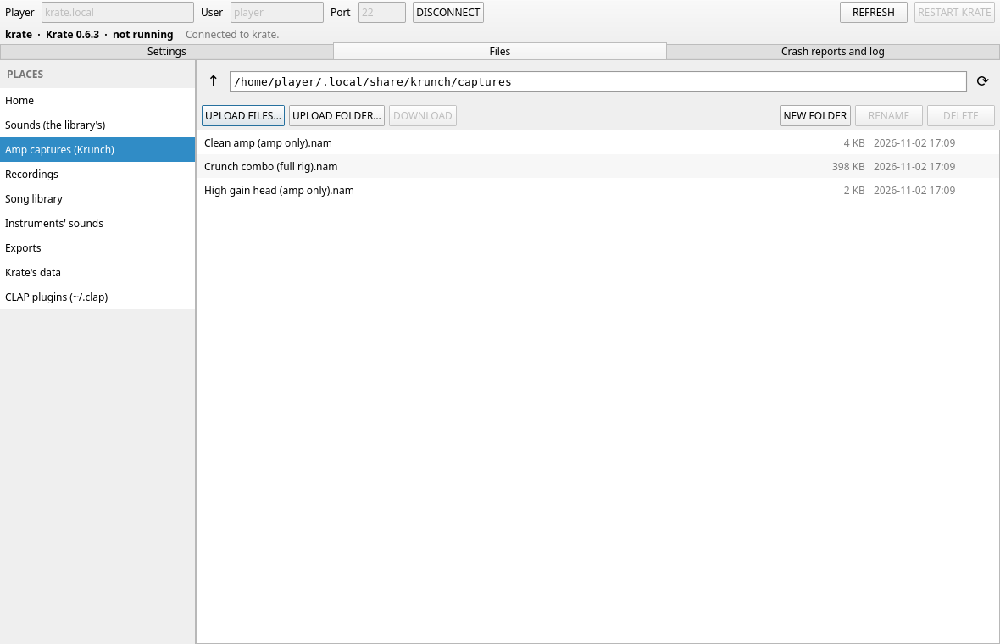

### Connecting

| Control | What it does |
| --- | --- |
| **Player** | The player's name on the network (`krate.local`) or its address. |
| **User** | The user Krate runs as on the player. |
| **Port** | SSH's port: 22 unless you changed it. |
| **CONNECT** / **DISCONNECT** | Logs in, or out. If the player asks for a password, a field appears for it. |
| **SET UP KEY LOGIN** | Makes a key for this app and puts it on the player: no password from then on. |
| **REFRESH** | Reads the player's state again. |
| **RESTART KRATE** | Quits Krate on the player properly (it saves as usual) and the player starts it again in a few seconds. Anything playing stops. |

The top shows the player's name, its Krate version and whether Krate is running. A player whose identity changes (reinstalled, say) is refused until you remove its old key from this computer's list of known hosts.

### Settings page

The player's settings, as on its **⚙** screen: **Folders** (**CHANGE…**, with **FOLDER OPEN IN FILES** to use the folder you're looking at, then **MOVE MY FILES THERE** or **USE WHAT'S THERE**; **DEFAULT**; **CANCEL**; **RESTART KRATE NOW**), **Plugin folders** (**ADD**, **REMOVE**, **USE FOLDER OPEN IN FILES**), **MIDI** (the inputs, **APPLY**, and Program Change) and **Updates** (checking by itself). Krate on the player picks the changes up at once, except the folders, which wait for its next start.

Audio, your MIDI keyboard's keys and the instruments' own settings are set on the player. Installing an update is done there too (**⚙ ▸ Updates ▸ UPDATE TO**), since it needs whoever sits at it.

### Files page

**PLACES** lists the folders you'll want on the player:

| Place | What goes there |
| --- | --- |
| **Home** | The player's home folder. |
| **Sounds (the library's)** | Samples and sample packs. They show up in the Sounds library by themselves a moment later, folders and all. |
| **Amp captures (Krunch)** | Amp capture files for Krunch: they show up in Krunch's **AMP** list by themselves. |
| **Amp heads (Krunch)** | Amp head files for Krunch (made by fitting Krunch's tubes to a capture on your computer): they show up in Krunch's **AMP** list by themselves. |
| **Recordings**, **Exports** | The audio tracks' takes, and what **EXPORT** wrote: download them to mix or keep elsewhere. |
| **Song library**, **Krate's data**, **Instruments' sounds** | Krate's other folders. Klang's and Kessel's `samples` folders are under **Instruments' sounds**, and show up in the Sounds library too. |
| **Plugins** | The plugin folders. |

Cabinet impulse responses for Krunch (WAV files) have no place of their own: upload them to a folder on the player (Home, say) and import them on Krunch's panel. Songs (tab and MIDI files) can go anywhere: open them on the player's **Song** screen, which adds them to the library.

| Control | What it does |
| --- | --- |
| The path field, **↑**, **⟳** | Any folder; the folder above; look again. |
| **UPLOAD FILES…**, **UPLOAD FOLDER…**, or drop files from your file manager | Sends them into the folder that's open (a folder with everything in it). Names already there are asked about first. |
| **DOWNLOAD** (or double-click a file) | Brings the selected files and folders to this computer's Downloads folder (**CHANGE…** picks another, **OPEN** opens it). A name already taken becomes `name (2)`. |
| **NEW FOLDER**, **RENAME**, **DELETE** | As they say. **RENAME** never writes over another file; **DELETE** asks first, and takes folders with all they hold. |
| **CANCEL ALL** / **CLEAR** | Stops the transfers, or clears the finished ones from the list. |

A click selects a file, Ctrl+click adds to the selection, Shift+click selects a range, a double click opens a folder. Files go one at a time, each with its progress. A transfer that's cut off leaves nothing half-written at either end.

### Crash reports and log

The player's crash reports, newest first, and Krate's log for this session and the one before. Click one to read it.

## Where your files are

| Where | What |
| --- | --- |
| `~/.config/krate/settings.json` | Settings (folders, MIDI inputs, updates). |
| `~/.config/krate/rack.json` | The rack's set-up: tempo, focus, what's in the rack, the mixer, routing, MIDI Learn, audio. |
| `~/.config/krate/plugins.json` | Which plugin each slot holds, and its state. |
| `~/.local/share/krate` | Krate's data: the sequencer (`sequencer.json`), the sound library's index (`sounds.db`), crash reports, the log. |
| `~/.local/share/krate/sounds` | Krate's sounds folder: always in the Sounds library. |
| `~/.local/share/krate/recordings` | The audio tracks' takes (WAV files). |
| `~/.local/share/krate/library` | The songs you've added (tab and MIDI files, backing tracks), and the library of songs and saved sequences. |
| `~/Music/Krate` | Exports: the song, and its stems in a folder beside it. |
| `~/.local/share/<instrument>`, `~/.config/<instrument>` | Each instrument's patterns, patches, kits, samples and settings, shared with its own app. |

All of these but the settings can be moved in **⚙ ▸ Folders**.

## Troubleshooting

- **No sound**: is the audio status LED lit? Click it to reconnect, or check **AUDIO ▸ Output**. Is the master fader up, a strip muted, another strip soloed?
- **Crackles**: a bigger **Buffer** (**AUDIO**).
- **The keyboard plays the wrong instrument**: it plays the one in focus (the lit tab). Check **KEYS ▸ Keys play focus on**, and the mixer's **CH** boxes.
- **I hear my guitar twice, once dry**: an audio track is armed with **MONITOR** on **AUTO** (or **ON**). Disarm it, or set **MONITOR** to **OFF**.
- **A recording is silent**: check the track's **SOURCE** and **CHANNELS**, and its **IN** meter; in **AUDIO**, is that **IN** wired to the right input of your audio interface?
- **The arrangement doesn't play**: switch **SONG** on. **LOOP** and **PUNCH** only work with **SONG** on.
- **The Seq screen doesn't play**: press **RUN**; check each track has an instrument and isn't muted (**M**).
- **A folder change didn't happen**: folders change when Krate starts again (**RESTART KRATE NOW**).
