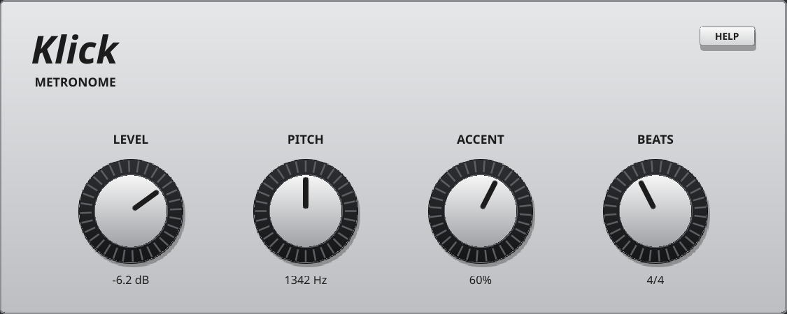

# Klick manual

Klick is Krate's metronome: a short click on every beat of the rack's transport, the first beat of each bar accented. It follows the tempo by itself, starts with the transport and is silent while it's stopped. Four knobs set how loud it is, its pitch, how much the bar's first beat stands out, and how many beats a bar has.

Drag a knob (or use the mouse wheel over it) to change it; its value shows under it; double-click to put it back to its default.

## Quick start

1. **Put it in the rack.** Klick is in the Krate rack (one only: it has no copies).
2. **Start the transport** (**PLAY / STOP** in Krate's transport bar): Klick clicks on every beat, at the rack's tempo. Stop, and it stops.
3. **Set the bar.** Turn **BEATS** to the number of beats in your bar (**4/4** by default): the first beat of each bar clicks higher and louder.
4. **Make it sit in the mix.** **LEVEL** for how loud, **PITCH** to move the click away from the instruments you're playing, **ACCENT** for how much the bar's first beat stands out.

## How Klick makes sound

Each click is a short sine burst that dies away in a few milliseconds, triggered on the exact sample each beat starts, so it is always in time with the rack (and with what you record against it). The bar's first beat is played louder and higher (up to a fifth higher), by the **ACCENT** amount. Klick plays the same click on both sides.

## LEVEL

| Control | What it does |
| --- | --- |
| **LEVEL** | How loud the click is, from silent (−inf dB) up to 0 dB (−3.1 dB by default). The bar's accented beat plays at this level; the other beats softer, by the ACCENT amount. |

## PITCH

| Control | What it does |
| --- | --- |
| **PITCH** | The click's pitch, 600 … 3000 Hz (about 1340 Hz by default). Low is a soft wooden tock; high a sharp tick that cuts through a loud band. Pick a pitch that isn't buried by what you're playing: higher under distorted guitars, lower if a high click is tiring. |

## ACCENT

| Control | What it does |
| --- | --- |
| **ACCENT** | How much the first beat of each bar stands out, 0 … 100 % (60 % by default): the other beats are softer (down to half as loud at 100 %) and the bar's click higher (up to a fifth). At 0 % every beat clicks the same. |

## BEATS

| Control | What it does |
| --- | --- |
| **BEATS** | Beats in a bar, 2 … 7 (six positions, shown as **2/4** … **7/4**; **4/4** by default). The accent falls on the first beat of each bar, counted from the start of the song. Use **3/4** for a waltz, **6/4** or **7/4** for odd meters. |

## Following the transport

- Klick plays only while Krate's transport plays, at the transport's tempo: change the tempo and the click follows at once.
- Starting the transport (from the top or from anywhere) clicks on the first beat right away.
- Bars are counted from the song's beat 0, so the accent lines up with the arranger's bars when BEATS matches the song's bar.

## In the mixer, recording and export

- Klick has its own mixer strip, like any instrument: turn it down or mute it there.
- When you record an audio track, Klick is a reliable guide: its clicks land on every beat, sample-aligned with the take. Don't record from Klick's output unless you want the click on the take.
- When you export a song from the arranger, the metronome is left out unless you press **METRONOME** in the export window.
- Klick's knobs can be automated in the arranger, like any instrument's (a lane changing its PITCH, for instance).

## Settings kept

Klick's knobs are kept when you quit, and in a song's sounds when you save them on the Song screen.

## Troubleshooting

- **No click**: is the transport playing? Is **LEVEL** up, and Klick's strip in the mixer up and unmuted?
- **The accent is on the wrong beat**: set **BEATS** to the song's bar. The accent counts from the start of the song, so a song that starts with a pickup bar shifts it.
- **The click is lost in the mix**: raise **PITCH** and **LEVEL**, or **ACCENT** to make the bar easier to hear.
- **The click is in your export**: turn **METRONOME** off in the export window.
