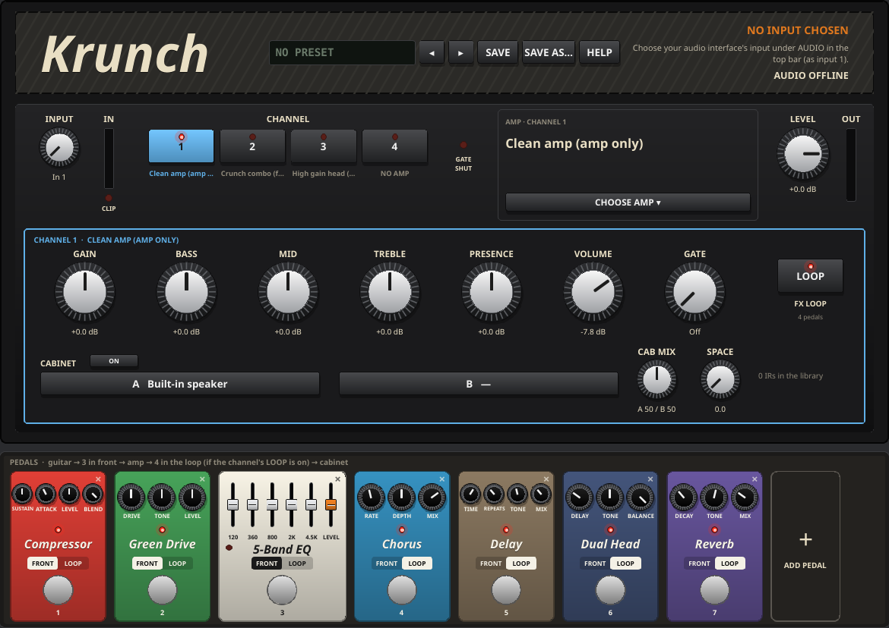
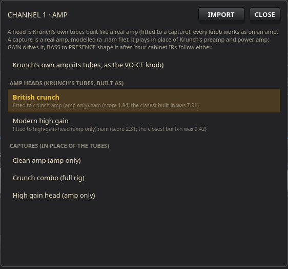
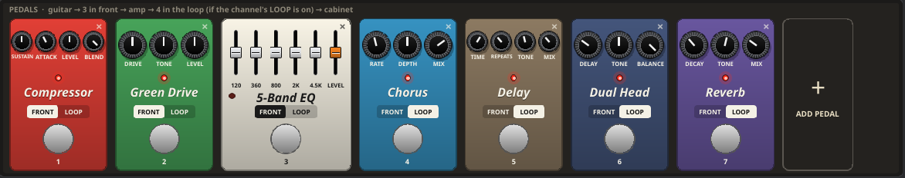

# Krunch manual

Krunch is a guitar amp: four channels, each with its own voice (Clean, Crunch, Heavy or Lead), gain, tone stack, volume and noise gate; a power amp with its own tubes, sag and resonance; two cabinets per channel from your own impulse responses (IRs), spread across the stereo field if you like; a pedalboard of up to eight pedals in front of the amp or in its effects loop; and, on any channel, an amp capture in place of Krunch's own tubes. Presets keep the whole rig by name.

This manual goes through the panel from top to bottom: the grille (presets and where the guitar comes from), the control plate (input, channels, power amp, the playing channel and its cabinet) and the pedalboard. Drag a knob (or use the mouse wheel over it) to change it; its value shows under it; double-click to put it back to its default.



## Quick start

1. **Plug in.** Plug your guitar into your audio interface's instrument input. In Krate's top bar, open **AUDIO** and choose that interface input as input 1 (or 2).
2. **Pick the input.** Set Krunch's **INPUT** knob to that input (**In 1** or **In 2**). The grille shows **GUITAR** and the input's name once it's connected; play and the **IN** meter moves. If the **CLIP** light flashes, turn the interface's own gain down.
3. **Pick a channel.** Press **1**, **2**, **3** or **4** under **CHANNEL**: out of the box they're Clean, Crunch, Heavy and Lead.
4. **Shape it.** Turn **GAIN** for more or less distortion, **BASS**, **MID**, **TREBLE** and **PRESENCE** for the tone, **VOLUME** to balance the channel with the others, and **MASTER** and **LEVEL** for how loud it all is.
5. **Add a cabinet.** Click the **A** bar under **CABINET** and import your IRs (WAV files, folders or zip packs). Click one to hear it at once.
6. **Add pedals.** Click **+** (**ADD PEDAL**) on the pedalboard and choose one; its footswitch turns it on and off.
7. **Keep it.** Press **SAVE AS…** on the grille and give the rig a name.

If the grille's **DELAY** line is orange, the trip from your guitar to the speakers is over 12 ms, which you can feel when you play: set a smaller buffer (128 frames is a good start) under **AUDIO**.

## How Krunch makes sound

```
guitar ─► front pedals ─► gate ─► PREAMP (the playing channel: tubes, a head, or a capture) ─► channel VOLUME
       ─► loop pedals (if the channel's LOOP is on) ─► POWER AMP ─► CABINET (IRs A and B, or the built-in speaker) ─► LEVEL ─► out
```

Only the playing channel's preamp runs. Switching channels crossfades over 15 ms, so it never clicks, and each channel keeps its own knobs and cabinet. The amp is mono up to the cabinet; a stereo IR, **SPACE** or the **Dual Head** pedal makes it stereo.

## The grille: presets and input

| Control | What it does |
| --- | --- |
| **The preset name** | The preset you're playing, in green, with a **\*** once anything has changed since it was loaded or saved; **NO PRESET** if none. Click it for the list of presets: click one to load it, **RENAME** it, or **DELETE** it (press twice: **SURE?**). |
| **◂ ▸** | The previous or next preset, round the list. Both are MIDI-learnable, for a foot controller. |
| **SAVE** | Saves the rig over the current preset (lit orange while it's modified). With no preset, it asks for a name. |
| **SAVE AS…** | Saves the rig as a new preset: type a name and press **SAVE** (or **CANCEL**). A name that's taken is replaced, and it says so first. |
| **GUITAR** | The interface input Krunch is playing. **WAITING FOR** that input means the device isn't there yet (is it plugged in?); **NO INPUT CHOSEN** means none is chosen under **AUDIO** for Krunch's **INPUT**. |
| **DELAY** | How long your guitar takes to reach the speakers, and the buffer size. Under about 10 ms feels like playing an amp; over 12 ms it turns orange. **AUDIO OFFLINE**: Krate isn't connected to the audio system. |

A preset is the whole rig: every knob of the four channels and the power amp, which channel plays, each channel's amp capture and cabinet IRs, and the pedalboard. Presets are kept in `~/.local/share/krunch/presets.json`. Saving a song's sounds on the Song screen keeps the same snapshot with the song.

## Input, meters and channels

| Control | What it does |
| --- | --- |
| **INPUT** | Which of Krate's two inputs Krunch plays: **In 1** or **In 2**, as set under **AUDIO** in the top bar. Set it to the interface input your guitar is plugged into. |
| **IN** | The input meter: how hot the guitar comes in. |
| **CLIP** | Lights when the input clips: the interface's gain is too high. Turn it down on the interface. |
| **CHANNEL** **1** – **4** | Picks the playing channel; the lit one is playing, its voice named under it. Each is learnable, to switch channels from a foot controller. |
| **GATE SHUT** | Lights while the playing channel's noise gate is closed (you're not playing). |
| **LEVEL** | Krunch's output level, −60 … +12 dB (all the way down: silent). |
| **OUT** | The output meter. |

## Power amp

Shared by all four channels, between the effects loop and the cabinet. A channel playing an amp capture skips it (the capture has its own power stage).

| Control | What it does |
| --- | --- |
| **MASTER** | How hard the preamp drives the power tubes, 0 … 10. Low, the power amp stays clean; up high it breaks up and compresses, as a cranked amp does. |
| **SAG** | How much the power supply droops when you dig in, 0 … 10: up, hard picking squashes and blooms, as an old amp with a soft supply does. |
| **RESONANCE** | A lift around 100 Hz going into the power amp, 0 … +10 dB: the thump of a closed-back cabinet on palm mutes. |
| **TUBES** (**POWER AMP**) | The power tubes, with ◂ ▸: **British pentode** (early, mid-forward breakup), **American beam** (clean headroom, scooped mids), **Small pentode** (chimey, compresses early, little headroom), **Big beam** (huge headroom, tight big lows). Changing tubes changes the feel more than the level. |

## The playing channel

The box in the middle of the plate shows the playing channel's controls, its border in the channel's colour. Every channel has its own.

| Control | What it does |
| --- | --- |
| **VOICE** | The kind of amp the channel is (4 positions; dimmed while the channel plays an amp head or a capture, which are their own kind of amp): **Clean** (two gentle stages and an American-style tone stack: sparkle and headroom), **Crunch** (three stages and a British-style tone stack: classic rock crunch that cleans up when you play softer), **Heavy** (four stages, tight lows: modern high gain), **Lead** (four stages, smoother and singing: sustain for solos). |
| **GAIN** | How hard the preamp is driven, 0 … 10: clean to full distortion, depending on the voice. With a capture: how hard you drive the capture, −12 … +12 dB (noon: as it was captured). |
| **BASS**, **MID**, **TREBLE** | The tone stack, 0 … 10, as on an amp: the knobs interact, and the mids scoop as on the real thing. With a capture: an EQ after it (noon is flat). |
| **PRESENCE** | The top end after the tone stack, −6 … +9 dB above 3 kHz: bite and air, or a softer edge. |
| **VOLUME** | The channel's own level, −40 … +6 dB (all the way down: silent). Use it to balance the channels, so switching from rhythm to lead jumps by as much as you want. |
| **GATE** | The noise gate, before the preamp: **Off**, or a threshold of −80 … −20 dB. Turn it up until the hiss and hum stop between notes, but not so far that it cuts your notes' tails. |
| **PREAMP TUBES** | The channel's preamp tubes, with ◂ ▸: **High gain** (the most gain), **Smooth** (a little less, softer clipping), **Medium** (more headroom), **Low gain** (barely clips: clean even when pushed). Hidden while the channel plays an amp head or a capture (they have their own). |
| **AMP** | The channel's amp: **KRUNCH TUBES** (its own preamp and power amp, as the VOICE knob), the name of an amp head (Krunch's tubes built like a real amp), or the name of an amp capture. Click it to choose (see Amp heads and Amp captures, below). |
| **LOOP** (**FX LOOP**) | The channel's effects loop on or off (lit: on). On, the pedals placed in **LOOP** play between the preamp and the power amp; the line under it counts them. Learnable (it switches the playing channel's loop). |

## Amp captures

A capture is a real amp, modelled: a small file made by playing recordings through the amp and training a model on how it answered, distortion and feel included. A channel can play one in place of Krunch's preamp and power amp. Krunch reads `.nam` capture files, an open format; thousands are shared for free on community capture sites by players who made them. Most are made at 48 kHz, the rate the player runs at (another rate plays too, with a note in the picker).



| Control | What it does |
| --- | --- |
| **AMP** | Opens the picker for the playing channel: **Krunch's own amp (its tubes, as the VOICE knob)**, then the **amp heads**, then the **captures**. Click one to play it at once (a capture loads in the background), so you can play and compare. |
| **IMPORT** | Opens a file dialog: the `.nam` captures and `.json` heads you choose are copied into their folders. You can also drop files on the picker. |
| **CLOSE** | Closes the picker. |

**Getting captures in.** Three ways, all into Krunch's captures folder, `~/.local/share/krunch/captures`:

- **IMPORT** in the picker, or drop the files on it;
- copy them into the folder yourself (files that land there show up by themselves);
- from your phone or another computer, **Krate Remote**: **Files ▸ Places ▸ Amp captures (Krunch)**, then upload or drop them.

**Amp-only or full rig?** An amp-only capture (the amp into a load, no speaker) wants a cabinet after it: keep the channel's **CABINET** **ON** and choose IRs. A full-rig capture already has a miked cabinet in it (look for "cab", "mic" or "full rig" in its name or description): set the channel's **CABINET** to **OFF**, or you hear two cabinets, muffled and boxy.

With a capture on a channel, **GAIN** drives it and **BASS**, **MID**, **TREBLE** and **PRESENCE** become an EQ after it; **VOLUME**, **GATE**, **FX LOOP**, the cabinet and the pedals work as always. **VOICE**, **PREAMP TUBES** and the power amp (**MASTER**, **SAG**, **RESONANCE**, **TUBES**) aren't used, and dim. Captures play at a common loudness, so switching between them doesn't jump.

## Amp heads

An amp head is Krunch's own tube amp built like a particular real amp: how many preamp stages and how each is biased and filtered, the tone stack, how the power tubes break up and sag. The four VOICE positions are the built-in heads; others are files, made on your computer by fitting Krunch's tubes to an amp capture of the amp you want (see the heads guide, `docs/HEADS.md`, in Krunch's folder). Unlike a capture, every knob on a head works as on the amp: **GAIN**, the tone stack, **PRESENCE**, **MASTER**, **SAG** and **RESONANCE** move it around the sound it was fitted to (all at noon: the capture's sound), and it costs far less processing.

- **Choose one** in the **AMP** picker, under **AMP HEADS**: each shows its name and what it was fitted to (and how close: lower is closer).
- **VOICE** and **PREAMP TUBES** dim while a head plays (it has its own tubes), and so does the power amp's **TUBES** when the head has its own power tubes.
- **Getting heads in**: **IMPORT** in the picker (`.json` files), copy them into `~/.local/share/krunch/heads`, or **Krate Remote**: **Files ▸ Places ▸ Amp heads (Krunch)**.
- **Making heads**: record dry takes of your guitar once (an audio track with no amp), get amp-only captures of the amps you like, and run `krunch-fit` on your computer: it writes a head for each capture, a report of how close it got, and files to compare the capture and the head by ear.

## Cabinet

Each channel has its own cabinet: two IR slots, **A** and **B**, mixed, or Krunch's built-in speaker when neither is chosen.

| Control | What it does |
| --- | --- |
| **CABINET** **ON** / **OFF** | The channel's cabinet on or off. **OFF**: no IR and no speaker, the amp straight out ("bypassed" shows), for a capture with its cabinet in it. Learnable (it switches the playing channel's cabinet). |
| **A**, **B** | The channel's two IRs. Click one to open the IR library and choose. **A** with no IR is the **Built-in speaker**; **B** can be **None**. |
| **CAB MIX** | The balance between A and B, from **A 100 / B 0** to **A 0 / B 100** (with both IRs chosen). Two different cabinets or mics blended make a fuller sound than either. |
| **SPACE** | Stereo spread between the two cabinets, 0 … 10: at 0 both play in the centre; turning up moves A to the left and B to the right, hard left and right at 10. With one IR or none it does nothing. |
| **IRs in the library** | How many IRs the library holds. |

**The IR library** (click **A** or **B**):

| Control | What it does |
| --- | --- |
| **Search** | Filters the list by pack, folder or name. |
| **The list** | Click an IR to play it at once, so you can compare while you play; double-click to choose it and close. **STEREO** and its length show on the right. |
| **★** | Marks a favourite: favourites are listed first. |
| **IMPORT FILES…** | Adds WAV files or zip packs to the library. |
| **IMPORT FOLDER…** | Adds a whole folder (WAVs and zips, with its subfolders). |
| **DONE** | Closes the library. |

You can also drop IR files, folders or packs anywhere on the amp. Each IR is copied into the library once (the same file is never added twice) and played at a common loudness, so switching IRs doesn't jump. A stereo IR makes the amp stereo.

## The pedalboard

Under the amp: up to eight pedals, left to right. Each is placed **FRONT** (in front of the amp, before the gate) or **LOOP** (in the channel's effects loop, between the preamp and the power amp, played while the channel's **LOOP** is on). Each group plays in the board's order, as the line at the top says: guitar → front pedals → preamp → loop pedals → power amp. Drives and fuzzes belong in front; time effects (delay, reverb, chorus) in the loop, after the distortion, so the echoes stay clean. A new pedal goes where its kind belongs.



| Control | What it does |
| --- | --- |
| **+** (**ADD PEDAL**) | Adds a pedal at the end of the board, from a menu of all 18. |
| **The footswitch** | Turns the pedal on and off; its light shows it's on. Switching crossfades, so it never clicks. Learnable by its place on the board (pedal 1 … 8, the number under it). |
| **FRONT** / **LOOP** | Puts the pedal in front of the amp or in its effects loop. |
| **×** | Takes the pedal off the board (it fades out first). |
| **Drag** | Drag a pedal by its body to move it along the board. |

The board scrolls sideways once its pedals are wider than it. It's kept in `~/.config/krunch/pedals.json`, and in presets.

## Pedals: drive, fuzz and dynamics

| Pedal | Knobs | What it does |
| --- | --- | --- |
| **Compressor** | **SUSTAIN**, **ATTACK**, **LEVEL**, **BLEND** | Evens your playing out and lengthens notes. SUSTAIN: more squash (the level made up, so more isn't quieter); ATTACK: how fast it grabs, 0.5 … 50 ms (slower lets the pick through); BLEND: how much of the compressed sound against the dry (keep some dry for the pick's attack). Best first on the board. |
| **Green Drive** | **DRIVE**, **TONE**, **LEVEL** | The classic green mid-boost overdrive: the bass stays tight, the mids push. In front of a crunchy channel it tightens and sharpens the distortion; in front of a clean one, a smooth overdrive. LEVEL −24 … +12 dB. |
| **Round Fuzz** | **FUZZ**, **VOLUME**, **BIAS**, **TYPE** | The classic two-transistor round fuzz. FUZZ cleans up as you pick softer or roll the guitar's volume back. BIAS off centre makes quiet notes sputter (the dying-battery sound). TYPE: **Germanium** (softer, warmer) or **Silicon** (more gain, brighter). |
| **5-Band EQ** | **120**, **360**, **800**, **2K**, **4.5K**, **LEVEL** | Sliders at guitar-centred frequencies (Hz), ±15 dB, flat in the middle; LEVEL (the orange slider) ±12 dB. In front it shapes what drives the amp; in the loop, the amp's finished tone. |
| **10-Band EQ** | **31** … **16K** (octaves), **LEVEL** | Ten octave-wide sliders, ±12 dB; LEVEL ±12 dB. A double-wide case. |

## Pedals: modulation

| Pedal | Knobs | What it does |
| --- | --- | --- |
| **Phaser** | **SPEED**, **MODE** | The classic one-knob four-stage phaser: two notches moving through the low mids. MODE: **Smooth**, or **Deep** (resonant, more vocal). |
| **Flanger** | **RATE**, **RANGE**, **COLOR**, **MATRIX** | The jet-plane sweep. RANGE sets how far it sweeps; COLOR adds feedback for a metallic, resonant sound. MATRIX stops the sweep: RANGE then sets a fixed comb by hand. |
| **Vibe** | **SPEED**, **INTENSITY**, **MODE** | The classic lopsided, throbbing photocell swirl. MODE: **Chorus** (mixed with the guitar) or **Vibrato** (a pitch wobble alone). |
| **Chorus** | **RATE**, **DEPTH**, **MIX** | A copy of the guitar slightly detuned and swept: shimmer and width. |
| **Tremolo** | **RATE**, **DEPTH**, **SHAPE**, **LEVEL** | The volume pulsing, as an amp's tremolo. SHAPE from a smooth sine to a choppy square; DEPTH from a gentle pulse to full chop. Starts in the loop. |

## Pedals: time and space

| Pedal | Knobs | What it does |
| --- | --- | --- |
| **Delay** | **TIME**, **REPEATS**, **TONE**, **MIX** | Echoes that darken and soften as they go, 40 ms … 1.5 s; even full REPEATS never runs away. Turning TIME while it plays bends the pitch, as a tape delay does. |
| **Drum Echo** | **TIME**, **HEADS**, **SWELL**, **TONE**, **MIX** | The old multi-head magnetic drum echo: four heads at 1, 2, 3 and 4 times TIME. HEADS picks which play (1, 1+2, 1+3, All); SWELL feeds them back into a rhythmic swell. |
| **Reverb** | **DECAY**, **TONE**, **MIX** | A room to a hall, 0.4 … 8 s. |
| **Dual Head** | **DELAY**, **TONE**, **BALANCE** | Splits the amp's sound into two amps set apart: the left is the amp, the right a copy **DELAY** later (0 … 40 ms), voiced by **TONE** (darker … brighter) and at **BALANCE** (−12 … 0 dB). A few milliseconds make it wide; 20–40 ms sound like two amps across a room. With **SPACE** up and two IRs, each amp has its own cabinet (A left, B right). It works at the amp's output wherever it sits on the board (in the loop, it follows the channel's **LOOP**). |

## Pedals: signature rigs

Each is a whole rig for one well-known sound in one pedal, each part brought in by its own knob (0 takes it out). Put them on a channel with the **Clean** voice and its **GAIN** low (the pedal is the drive), in **FRONT**.

| Pedal | Knobs | What it does |
| --- | --- | --- |
| **Prism** | **FUZZ**, **VIBE**, **ECHO**, **TIME**, **SPACE**, **TONE**, **LEVEL** | The early-70s spacey singing lead and clean sound: a round fuzz, a slow vibe swirl, a multi-head drum echo (TIME sets its first head) and plenty of reverb (SPACE). Best on a clean channel with headroom. |
| **Madman** | **GAIN**, **AMP**, **BASS**, **MIDS**, **TREBLE**, **DOUBLE**, **LEVEL** | The early-80s neoclassical metal sound: a distortion pedal into an EQ pushing the mids, slamming a cranked British amp (AMP, BASS, TREBLE), with DOUBLE adding a second "take" for a double-tracked width. Add a Delay or Reverb in the loop for leads. |
| **Pyramid** | **GAIN**, **BODY**, **MIDS**, **BITE**, **TWIN**, **ECHO**, **LEVEL** | The mid-80s British twin-guitar metal sound: a tightening boost into a medium-crunch British amp (BODY, MIDS and BITE as its bass, mid and treble), TWIN for two guitars, a touch of ECHO. |
| **Haze** | **OCTAVE**, **FUZZ**, **AMP**, **TONE**, **ROOM**, **LEVEL** | The late-60s psychedelic fuzz sound: OCTAVE adds the octave-up fuzz (best high on the neck), FUZZ a germanium round fuzz, AMP a cranked British amp, ROOM a short studio room. Roll your guitar's volume back and it cleans up. |

## MIDI and MIDI Learn

Krunch plays no MIDI notes, but its controls can be learned: press **LEARN** in Krate's top bar, click a knob or button on Krunch, then move a knob or press a button (or a footswitch) on your controller; they're linked.

- **Knobs**: every knob on the plate (**INPUT**, **MASTER**, **SAG**, **RESONANCE**, **LEVEL**, the channel's knobs, **CAB MIX**, **SPACE**).
- **Buttons**: **CHANNEL** 1–4, the playing channel's **LOOP** and **CABINET**, the pedals' footswitches by place (pedal 1 … 8), and the presets' **◂ ▸**. With a foot controller that's a whole floor rig: channels, loop, pedals and presets at your feet.

Every knob can also be automated from Krate's arranger.

## Tips

- **Hearing a second, dry guitar?** An armed audio track in Krate with **MONITOR** on **Auto** (or **On**) plays its input straight through, so you hear your dry guitar next to Krunch's. Disarm the track (or set its MONITOR to Off, or its source to Krunch's output if you want to record the amp).
- **No sound, or the wrong guitar?** Set Krunch's **INPUT** to the interface input your guitar is plugged into, and check that input under **AUDIO** in the top bar. The grille says **GUITAR** when it's connected.
- **Muffled, boxy capture?** It's probably a full-rig capture: set **CABINET** to **OFF**.
- **Hiss between notes**: turn **GATE** up until it stops, on the high-gain channels especially.
- **Too much fizz** with high gain: lower **PRESENCE** and **TREBLE**, try another IR, or put a Green Drive in front with its DRIVE low and LEVEL up to tighten the amp instead of more GAIN.
- **Rhythm and lead**: set the Lead channel's **VOLUME** a few dB over the rhythm channel's, learn **CHANNEL** buttons to a foot controller, and save the rig as a preset.
- **Wide and big**: two different IRs on **A** and **B**, **SPACE** up, and a **Dual Head** at 10–20 ms.
